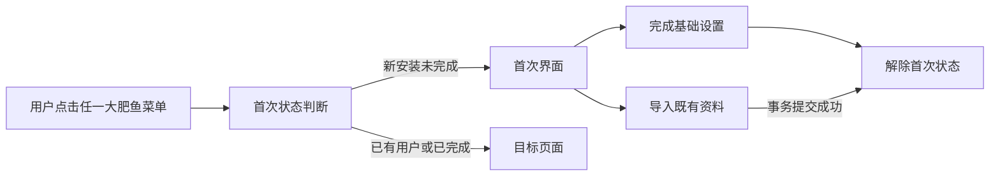
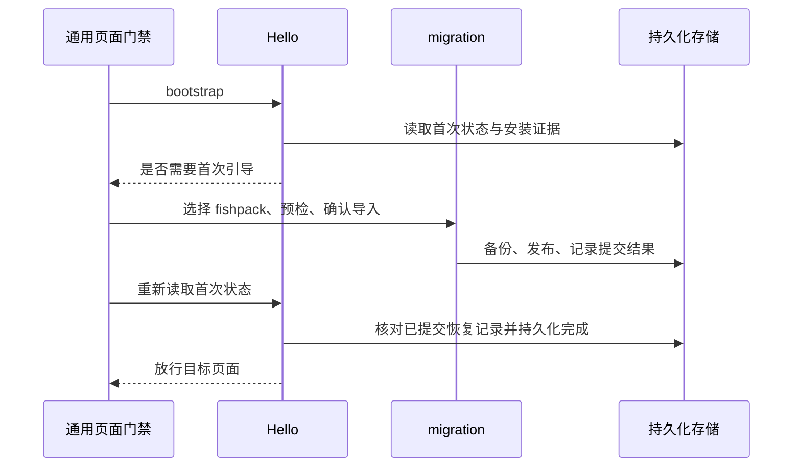
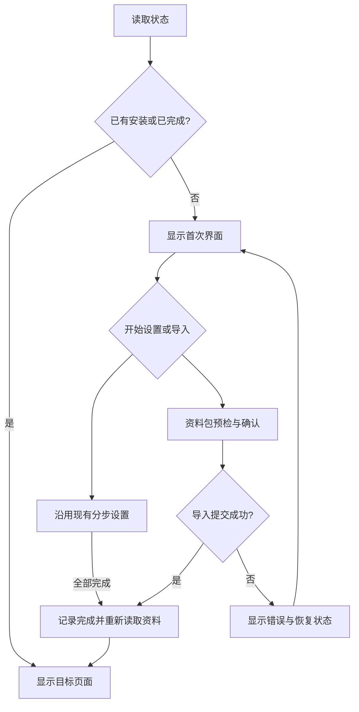

# 首次安装状态与资料恢复

**Status:** ARCHITECTURE-READY
**Goal:** 只有真正新安装进入首次状态；所有大肥鱼菜单统一拦截，首次界面支持导入设置导出的资料包。
**Non-goals:** 拦截 DSH 其他插件菜单、改写资料包格式、调整人格与感知业务规则。
**Decision:** 复用 Hello 持久化状态、统一页面门禁和现有 migration 导入事务。
**References:** `app/dsh/build.mjs`、`app/dsh/ui/hello/panel.js`、`core/modules/hello/service.js`、`app/dsh/ui/settings/panel.js`、`app/dsh/host/index.js`、`docs/data-migration-technical-v1.md`。

## Architecture Diagrams

### Business Architecture

门禁只决定页面展示；资料恢复由 migration 负责，不将引导做成菜单。失败仍停留首次状态。

### System Interaction

浏览器事件仅触发刷新，不作为导入成功凭据；服务端以持久化提交结果判断。导入后进程退出时，下次 bootstrap 同样完成核对。

### Core Flow

状态读取失败展示重试，不能默认放行；导入部分失败继续使用原事务恢复流程，不重新应用 Hello 草稿。

## Current Evidence

- `build.mjs` 注册独立 `chonkyfish-hello` 菜单；仅 chat 使用 `createHelloChatGate`，其余菜单绕过状态。
- `hello/panel.js` 的门禁在请求失败时放行；等待和欢迎页有直接聊天入口。
- Hello 状态有 `entryKind`、`status`、草稿与操作记录；当前已有用户判断只覆盖面板、感知开启与社交配置，不能证明其他资料不存在。
- 设置页已经实现 `.fishpack` 上传预检、确认替换、取消、提交及完成事件。
- Host 已提供 migration 提交回调；不得在迁移维护锁内调用需要同一锁的 Hello 写入。

## Proposed Boundary Contracts

- Hello 是首次状态的唯一所有者。保持现有字段兼容；已有安装不强制运行引导，不覆盖设置。
- Host 在模块初始化产生默认文件之前收集已有安装证据：已有面板状态、用户配置、日记、账本、技能、个人资料、感知偏好或社交配置。空目录与内置资源不作为旧安装证据；读取异常不得误判全新。
- 一旦持久化为新安装草稿，初始化产生的默认数据不把它误判为旧用户；已提交导入记录可以将其转为完成。
- 构建层删除首次见面菜单，给全部大肥鱼页面套统一门禁，包括直接打开页面和菜单切换。检查完成前不挂载目标业务页面。
- 欢迎页提供开始设置与导入资料。复用设置的导入组件（首次模式隐藏导出与设置页标题），保持相同校验、预览、确认和错误反馈。
- 导入成功不应用原 Hello 草稿；完成状态落盘后放行，并重新读取目标页面资料。所有已打开页面在下一次进入时重新核对状态。
- 不新增资料包版本、独立导入实现或浏览器完成标记。权限检查及迁移独占边界保持原归属。

## Options

1. **推荐：统一页面门禁 + 复用现有导入。** 覆盖所有入口，状态可靠持久化，改动集中于现有所有者。
2. 每个菜单分别判断并跳转欢迎页。重复判断容易遗漏，直接打开页面仍需补门禁，不采用。
3. 全局覆盖 DSH 壳层。会影响其他插件与宿主功能，超出本次范围，不采用。

## Compatibility and Recovery

- 已完成和已有安装直接放行；升级不能因为 Hello 文件缺失触发强制引导。
- 未完成新安装继续已保存步骤；部分提交仍保留原恢复操作。
- 非法包、取消与回滚不完成首次状态；恢复待处理时明确提示，继续阻止业务页挂载。
- 事务成功但 Hello 写入失败时，保留迁移持久化提交证据，下次读取补写完成；重复核对幂等，不重复导入。
- 发布时重新生成 `client.js`；不修改用户本机资料。

## Verification Contracts

- 对每个注册页面验证新安装拦截；等待与请求失败均不能绕过，完成后恢复目标页。
- 验证无 Hello 文件的旧安装（包含仅日记或技能等证据）免引导、空目录仍是新安装、读取失败可重试。
- 验证草稿跨页面和重启恢复、部分设置失败继续拦截。
- 用设置导出的真实资料包完成首次导入；重启后不再引导，导入人格不被草稿覆盖。
- 验证非法包、取消、事务失败回滚、提交后中断与完成落盘失败的重试。
- 运行 Hello、migration、资源注册测试及客户端构建；跨平台持久化继续沿用现有存储适配。

## Open Decisions

- 无。用户于 2026-11-16 明确回复「实施」，批准本方案。

## Revision History

| Date | Change |
| --- | --- |
| 2026-11-16 | 按用户要求将菜单改为首次安装状态，明确统一门禁与资料导入衔接 |

## Readiness Score

| Dimension | Max | Score | Evidence or deduction |
| --- | ---: | ---: | --- |
| Evidence and traceability | 15 | 13 | 已定位现有门禁、状态与迁移所有者 |
| Scope and decisions | 15 | 14 | 用户已明确行为并批准书面方案 |
| Boundaries and contracts | 20 | 17 | 不新建状态或导入所有者；安装证据扫描需实施细化 |
| Diagrams and explanations | 15 | 14 | 三类图与失败说明 |
| Compatibility and recovery | 15 | 13 | 旧安装、重启、导入完成补记 |
| Verification contracts | 15 | 13 | 入口、成功、失败、重试、平台适配 |
| Governance and readability | 5 | 4 | 用户已确认，保留实施核对记录 |
| **Total** | **100** | **88** | **用户已批准，无阻塞项** |

## 实施核对（2026-11-16）

- 首次草稿在默认配置与后台模块启动前持久化；`installationVersion: 1` 是 Hello 状态内的分类版本，不是新存储。
- 旧版无分类版本的 `new/draft` 记录若没有未决提交操作且存在业务资料，升级为已有用户；默认 config 和空目录本身不足以跳过旧草稿。部分提交保留恢复能力。
- 所有八个主页面使用 `createHelloGate`，删除 Hello 侧栏项和直接聊天绕过入口。读取失败可重试，目标页尚未挂载。
- 首次导入复用设置组件。已经放行的页面不会因导入事件被卸载，保留结果与重启提示；文件选择窗口的 focus 不触发重新挂载。
- Hello 根据 migration 已提交日志补记完成并废弃未完成的旧操作，不重放草稿；读写失败不会伪装成完成。
- Host 端到端测试发现原有迁移锁内 `perception.stop()` 会再次写偏好并返回 MIGRATION_BUSY。改为服务的 `suspendForMigration()` 仅停止运行，事务负责发布关闭偏好，`adoptImportedPreference()` 仅同步内存。导入发布前失败保留原持久化意图，采集保持停止。
- 新增真实导出→新安装导入→重启测试，以及完成落盘失败重试、旧版跳过引导、部分提交恢复、所有菜单与导入组件用例。

验证结果：`npm test`、`npm run build`、生成客户端启动检查通过；最后的旧版识别补充后再次通过 `npm run test:hello`。未进行实机 DSH GUI 验收。
