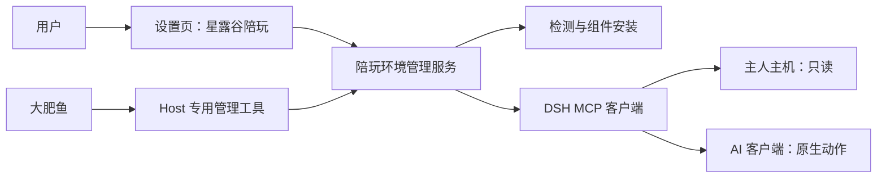
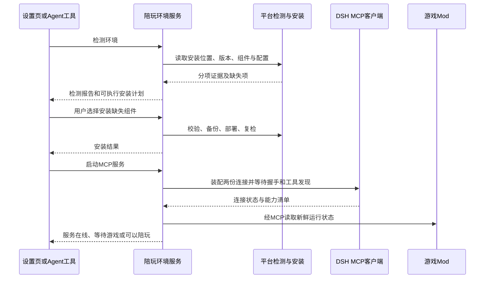
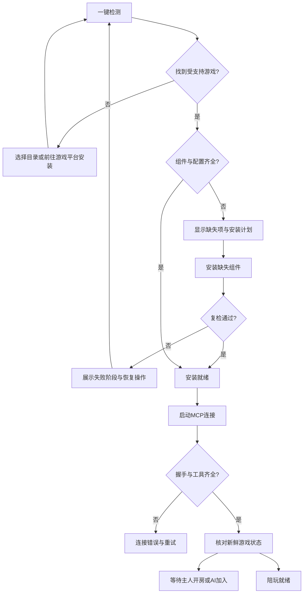

# 星露谷陪玩环境检测、安装与 MCP 生命周期设计 V1

- 日期：2026-11-16
- 状态：**DRAFT / 待评审，未实施**。
- 目标：用户无需手工编辑 profile，即可在大肥鱼设置页检测并准备星露谷陪玩环境；环境就绪后，大肥鱼可通过专用工具启动陪玩 MCP 服务。
- 范围说明：本文记录当前讨论与推荐方案，不代表 MCP 服务端已具备安装检测接口，也不代表配置页安装器已完成。

## 1. 背景与当前证据

用户提出四个问题：MCP 是否只能手工配置 profile；大肥鱼能否自行启动服务；能否知道游戏与依赖是否安装；配置页如何一键检测和安装。

本次核对对象为当前 ChonkyFish 仓库及本地 DSH 源码，未检查用户实际 Windows 游戏环境。

| 已核实事实 | 证据与含义 |
| --- | --- |
| DSH 的每个 MCP 客户端插件实例连接一个服务 | DSH `packages/mcp/mcp-client/src/index.ts`；连接后向工具注册表发布 `mcp__<serverName>__<rawName>` |
| stdio 由 DSH 启动子进程，HTTP 模式连接已有服务 | DSH `packages/mcp/mcp-client/src/transport.ts`；启动 stdio 不需要先手工运行同一个服务 |
| MCP 可以通过配置项、patch 或插件装配接入 | DSH `packages/boot/app-boot/README.zh.md`；无需将“用户编辑 profile 原文件”作为产品流程 |
| MCP 客户端具备连接、工具同步和重连生命周期 | 具体实现由 DSH 所有；大肥鱼不应另写一套重连器 |
| 本地 DSH 文档描述 stdio 协商可能先启动临时探测进程 | MCP 入口不能因进程启动而自动安装组件、启动游戏或加入农场；必须核对目标 DSH 版本的实际行为 |
| 当前陪玩使用 `stardew` 与 `stardew2` 两个别名 | 前者读取主人主机，后者控制 AI 客户端；bridge 与动作目录必须隔离 |
| 大肥鱼目前按已注册工具发现后台任务协议 | [任务协议适配](../app/dsh/adapters/tasks/protocols.js)；不是依赖安装器或 MCP 服务管理器 |
| 当前设置页只有资料迁移能力，没有星露谷环境管理 | [设置页实现](../app/dsh/ui/settings/panel.js) |
| 原生陪玩会话禁止任意 shell、文件写入、桌面输入等绕行能力 | [陪玩执行门禁](../app/dsh/adapters/tasks/companion-policy.js)；新增管理工具必须显式接入边界 |
| 游戏侧已有真实 LAN、独立玩家与输入隔离验收记录 | [原生陪玩说明](stardew-native-companion-2026-11-15.md)；属于特定版本与场景的记录，不能外推成所有版本均支持 |

本次未定位到对应 Stardew MCP 服务端和 Mod 的完整源码、发布清单及安装包。因此不能认定已有 dependency/doctor 工具，也不能猜测必须安装 Python、Node、.NET SDK 或某个额外 Mod。实际运行依赖须由对应发布物确认；构建依赖不能直接当成玩家依赖。

## 2. 目标与范围

### 2.1 产品目标

1. 设置页提供“一键检测”和“安装缺失组件”，检测失败能指出具体缺项与下一步。
2. 游戏已安装时，自动定位并核对；无法唯一定位时允许用户选择目录。
3. 自动准备陪玩组件和两份 MCP 连接，不要求用户理解 profile、serverName 或 bridge 路径。
4. 大肥鱼能够查询环境状态、启动和停止已配置的 MCP 服务；服务未启动时这些管理工具仍可用。
5. 设置页与 Agent 工具共享同一个 Host 服务及状态源。
6. 明确区分安装就绪、MCP 在线、游戏在线、可以陪玩。

### 2.2 V1 推荐范围

先覆盖 Windows 上已经验证过的双实例 LAN 陪玩形态：主人运行主机，AI 使用独立 farmhand 客户端。具体支持的游戏平台、版本组合与发布渠道仍待确认。

先交付环境检测、组件安装、连接配置及 MCP 服务生命周期；客户端游戏进程启动、LAN 加入继续作为不同操作处理。既有原生加入协议可以复用，但不能把“启动服务”默认为“启动游戏并加入”。

### 2.3 非目标

- 不代购、重新分发或静默安装游戏本体；缺少游戏时引导到游戏平台安装，再回来检测。
- 不自动替主人加载存档、开房、保存、退出或关闭游戏。
- 不让模型生成任意安装命令、下载地址、环境变量或目标路径。
- 不用窗口激活、模拟键鼠或通用 shell 作为原生陪玩失败后的替代路径。
- 不在 V1 同时承诺 macOS/Linux、远程机器部署和通用 MCP 应用商店。
- 不因健康检测执行农活、改变存档或加入未知主机。

## 3. 推荐方案与模块职责

推荐新增专用的星露谷陪玩环境管理服务，由 ChonkyFish Host 托管；保留 DSH MCP 客户端对连接和传输的所有权。

| 层次 | 负责 | 不负责 |
| --- | --- | --- |
| 设置页 | 展示检查结果、安装计划、进度和修复操作 | 文件系统扫描、运行安装命令、保存独立状态真源 |
| Agent 管理工具 | 有界查询与启停请求，返回明确状态 | 自定义命令、任意地址、静默扩展安装范围 |
| 陪玩环境服务 | 检测编排、安装计划、操作互斥、连接装配与就绪判定 | 自行复制 MCP 重连实现、游戏内动作执行 |
| 平台适配与存储 | Windows 安装定位、版本读取、受控文件部署和进程身份核对 | 从模型文字推断可执行命令 |
| DSH MCP 客户端 | stdio 子进程或 HTTP 连接、握手、工具发现、重连、卸载 | 判断游戏是否安装、替用户安装 Mod |
| Stardew MCP 与游戏 Mod | 游戏实时状态、原生会话和动作、输入隔离证明 | 承担服务尚未启动时的环境检测入口 |
| 现有后台任务与权限模块 | 操作回执、取消、恢复、执行门禁 | 把“后台任务”当成绕过能力约束的通道 |

拟沿用现有布局：`core/modules/` 承载环境用例；`app/dsh/adapters/` 接入 DSH 生命周期和工具；`app/shared/platform/` 承载平台操作；配置与路径由资源管理器统一提供。具体模块名、文件清单和路由在实现方案中确定，本文不预设已存在的 API。

### 3.1 业务架构

设置页和工具共享状态源。管理工具由 Host 注册，不依赖目标 MCP 已经在线，否则会出现“服务没启动，所以启动工具不存在”的循环依赖。游戏本体安装和主人开房仍是外部前提。

### 3.2 系统交互

安装并不是启动 MCP 的隐式副作用。实时游戏检查失败不推翻已验证的安装事实；例如游戏未打开时应显示“已安装，等待启动”。长任务返回操作 ID，页面关闭或对话继续不等于操作自动取消。

### 3.3 核心流程

本图的“等待”是正常运行状态。版本不兼容、安装失败、连接失败和游戏未运行应分别报告，不能统一显示“安装失败”。LAN 加入仍须明确请求并走已有原生任务协议。

## 4. 配置加载与 MCP 生命周期

### 4.1 自动配置

- 配置页保存用户选择的游戏位置与陪玩启用偏好，Host 生成两份受管理连接配置。
- 保留 `stardew` / `stardew2` 别名，以兼容现有工具发现和权限规则。
- `STARDEW_BRIDGE_PATH` / `STARDEW_ACTION_DIR` 从两个实例的真实配置推导并核对；不得指向同一位置。
- 遇到用户已有同名 MCP 连接，先识别归属和兼容性，不能直接覆盖或重复占用别名。
- 优先复用宿主支持的动态插件装配；若目标 DSH 版本只支持重载后应用，明确显示“配置已保存，需要重载”，不能提前宣称已在线。
- 持久化启用意图与运行中连接分开；Host 重启后按明确偏好恢复服务，不自动启动游戏或开房。
- stdio 连接的进程生命周期交给 DSH；HTTP 模式不能把“能配置 URL”误当成“能够启动远端服务”。V1 优先本机 stdio，最终以 MCP 发布形态确认。

### 4.2 拟新增 Agent 工具

以下是接口意图，名称和 schema 尚未实现：

| 工具 | 行为与返回 |
| --- | --- |
| `fish_companion_status(game: "stardew")` | 执行或查询检测；返回分项状态、检测时间、证据、阻塞项及下一步 |
| `fish_companion_start(game: "stardew")` | 检查安装就绪后启动 MCP 连接；已运行时复用，缺组件时返回缺项，不偷偷安装 |
| `fish_companion_stop(game: "stardew")` | 停止本服务拥有的连接；有游戏动作运行时先处理取消与结果核对，不强杀主人游戏 |

首次依赖安装由配置页展示计划后触发。若未来开放 Agent 安装入口，必须复用同一份受控计划和操作记录，而不是增加通用命令执行权限。

工具执行必须同时满足调用者身份、受支持游戏和操作范围约束，并纳入 `companion-policy` 与相关通话工具策略。不要宽泛允许所有 `fish_companion_*` 或任意名字相似的工具。

MCP 启动成功的最低证据是握手完成且必需工具发现完成。仅获得 PID、成功写入配置或工具列表保留旧名称，均不构成服务在线证明。

## 5. 检测模型与就绪标准

报告应分为互相独立的四组状态，而不是单一 `ready: true`：

| 维度 | 示例状态 | 主要证据 |
| --- | --- | --- |
| 安装 | 未找到、缺依赖、不兼容、就绪、未知 | 游戏与组件路径、版本、完整性、检测时间 |
| MCP 服务 | 未启动、启动中、在线、断开、失败 | 本次连接代次、握手与必需工具清单 |
| 游戏会话 | 未运行、标题界面、等待主机、加入中、已联机、未知 | 新鲜游戏状态及实例身份 |
| 陪玩能力 | 未就绪、可加入、已就绪、受限 | 同世界独立角色、原生动作协议、后台输入隔离 |

每个检查项返回：稳定检查 ID、状态、可读说明、证据时间、是否阻塞、建议操作。读取失败必须与“未安装”区分；安装检测不应依赖成功连接 MCP。

### 5.1 安装检测清单

1. Windows 及受支持架构。
2. 游戏安装目录、可执行文件和实际版本；多安装时由用户选择，不能只取第一个路径。
3. 对应发布包实际需要的运行时；缺少开发 SDK 不能自动认定运行环境不完整。
4. SMAPI 安装和版本；陪玩 Mod 的清单、程序集及兼容组合。
5. MCP 发布包、入口与文件完整性。
6. 主人与 AI 的实例路径、Mods 配置、bridge 路径、动作目录隔离及写入条件。
7. MCP 连接归属、别名冲突、启用偏好和保护策略。

### 5.2 运行检测清单

- 服务握手成功且 session/tool/travel 等实际启用功能需要的完整生命周期工具存在。
- bridge 状态新鲜，并与当前游戏实例身份匹配；残留文件不能证明在线。
- 主人实例已开放 Co-op，AI 已进入同一 worldId，localFarmerId 与 hostId 不同，AI 的实际角色为 farmhand。
- 主人实例保留实体输入；AI 实例具有有效原生控制租约及后台执行能力。
- AI 的 `physicalInputIsolation` 为 `active=true`、`installed=true`、`installError=null`；具体实现版本按兼容清单验证，不把历史拦截入口数量硬编码成永久标准。
- 没有已启动游戏时，离线检测只能证明安装条件，不能替代在线握手、Mod 加载或联机验收。

## 6. 设置页交互

入口拟为“设置 → 游戏陪玩 → 星露谷”，不新增一级 MCP 菜单。

页面显示四行：游戏安装、陪玩组件、服务状态、联机状态。提供“一键检测”“安装缺失组件”“启动陪玩服务”；失败时提供对应修复操作。

一键安装的含义：用户查看检测生成的安装计划后，用一个操作安装可自动处理的缺失组件、生成连接配置并复检。游戏未安装、目录不明确、需要系统交互或游戏正在占用待更新文件时，指出需要用户完成的具体步骤，再恢复原任务。

安装期间显示当前阶段、进度与结果；不能用固定计时器假装进度。服务在线但主人尚未开房时显示“等待主人开放联机”，不显示通用错误。

用户侧不展示 command、serverName 或环境变量作为必填表单；诊断详情可展示必要版本与路径，但不能包含凭证。

## 7. 安装事务、兼容与恢复

### 7.1 发布清单

安装器需要一份可验证的组件清单，列出组件 ID、来源、版本、平台、校验值、依赖、目标范围、安装/验证方法和兼容组合。使用受支持的已验证组合，不把“全部升级到最新版”当作修复策略。

- 游戏本体只定位和校验；缺失时进入游戏平台安装流程。
- SMAPI 从官方发布渠道获取；陪玩 MCP 与 Mod 的正式发布来源仍待确认。
- 尽量交付可直接运行的版本化发布包，减少要求玩家安装构建工具。
- 安装前复核计划对应的检测结果仍有效，避免检测后用户切换目录或版本。

### 7.2 操作与持久化

- 所有路径由资源管理器统一定义；环境配置、操作记录和组件缓存落在插件管理目录，具体 schema 待实现方案确定。
- 不修改存档。不得覆盖无关 Mod、用户 profile 配置或其他 MCP 连接。
- 更新前备份本次将修改的文件和配置，下载到暂存区并验证后再发布。
- 游戏运行且占用待更新组件时，暂停安装并提示关闭对应实例；不擅自关闭主人游戏。
- 同一安装目标串行执行；重复点击返回同一进行中的操作，避免两个安装器同时替换文件。
- 持久化阶段记录以支持中断恢复；失败展示“未修改”“已恢复”或“需要恢复”，不承诺第三方安装器的所有副作用都能回滚。
- 取消在安全阶段停止，正在发布的不可中断步骤须先完成一致性处理。再次进入设置页可查询原操作，而不是重复安装。
- 不把下载到本机的二进制包、游戏目录或环境绝对路径直接加入现有 `.fishpack` 迁移范围；换电脑后重新检测配置。

### 7.3 启停与异常

- MCP 入口应无游戏启动副作用，允许探测、重连或热重载产生新进程。
- 不为同一实例同时运行两套 DSH 客户端与自建进程监督器。
- MCP 断线不代表游戏动作已停止；继续沿用现有 unknown/取消确认规则，不能自动重放不确定动作。
- 停止服务只管理有明确所有权的连接和进程；主人游戏保持不变。
- 环境检测、安装或 MCP 启动失败不应阻断普通聊天和设置页读取。

## 8. 方案比较

| 方案 | 优点 | 代价与结论 |
| --- | --- | --- |
| 继续手工编辑 profile、安装各组件 | 代码改动少 | 用户负担重，配置和检测分散，不满足目标 |
| 专用 Host 环境管理服务，复用 DSH MCP 客户端 | 页面与工具共用状态，安装与连接职责清晰 | 需补检测、安装事务及宿主适配；推荐 |
| 让模型通过 shell 自行安装和启动 | 原型快 | 与当前陪玩执行门禁冲突，版本、进程和失败恢复不可控，不采用 |

## 9. 验证与验收标准

| 场景 | 必须得到的结果 |
| --- | --- |
| 全新机器未安装游戏 | 明确“未找到游戏”，可选择目录或打开游戏平台；不误报 MCP 故障 |
| 游戏已装但 MCP 未启动 | 无需 MCP 即可完成安装检测 |
| 自定义安装位置、多库或多份游戏 | 读取真实版本，选择目标后检查，不能配置到另一份游戏 |
| 仅缺运行时或 Mod | 只安装计划内缺项；不强制安装开发 SDK |
| 版本不兼容或校验失败 | 阻止不兼容发布，保留原组件并给出具体原因 |
| 已有手工配置或同名连接 | 识别归属和冲突，不重复注册或覆盖用户配置 |
| 重复安装、启动、页面刷新 | 不产生重复进程或重复发布；原操作可查询 |
| 下载失败、无写权限、安装中断、取消 | 提供准确阶段与恢复办法；重启后可恢复一致状态 |
| 游戏运行期间更新 Mod | 不替换占用中的文件，不强制关闭游戏 |
| MCP 启动或工具发现失败 | 管理工具仍能查询故障；不宣称服务在线 |
| stdio 探测、重连和热重载 | 不自动启动游戏、加入主机或执行重复游戏动作 |
| bridge 残留、过期或角色身份错误 | 服务可以在线，但陪玩不能被标记就绪 |
| 主人前台操作、AI 后台执行 | 两个独立玩家同世界；主人输入不被抢占，AI 隔离验证通过 |
| 游戏动作执行中停止或连接断开 | 不把未知结果当成功停止，不自动重放 |
| 未授权调用或越界参数 | 身份与能力范围检查拒绝；不能注入命令或绕过既有门禁 |
| 普通聊天与未配置陪玩环境 | 保持可用，不因组件缺失加载失败 |

自动化至少覆盖状态归约、检测适配、安装故障注入、进程幂等、工具注册与权限边界。实机验收覆盖受支持 Windows 平台、正式发布包、双实例输入隔离及真实 LAN 场景。自动化通过不代替游戏实机验收。

## 10. 实施顺序与待确认项

### 10.1 推荐里程碑

1. **只读检测**：定位 MCP/Mod 源码与发布物，确定依赖清单，完成检测报告和设置页展示；不先安装未知组件。
2. **服务生命周期**：明确 DSH 动态加载接口，自动配置两份连接，接入 Host 管理工具及权限策略。
3. **组件安装与恢复**：清单、下载校验、备份发布、进度、取消和中断恢复。
4. **实机闭环**：从缺组件环境走通安装、连接、独立游戏实例与 LAN 陪玩验证。

各阶段不能提前宣称最终的一键陪玩已完成；第一阶段可以独立验收。

### 10.2 Open Decisions

| 待确认事项 | 为什么影响实施 |
| --- | --- |
| 对应 Stardew MCP 与 Mod 仓库、版本及正式发布渠道 | 决定准确运行依赖、包校验、安装入口和升级策略 |
| V1 Windows 支持的平台发行版及游戏/SMAPI/Mod/MCP 兼容组合 | 决定路径发现、启动方式、可自动安装范围和实机矩阵 |
| 目标 DSH 版本可用的动态插件装配、配置持久化与健康状态接口 | 决定能否即时启停，以及何时需要重载；不能只依据邻接源码推定线上能力 |
| 双实例安装与运行目录的正式布局 | 决定 Mod、配置、bridge、动作目录和客户端进程所有权 |
| 第三方组件是否支持受控安装与恢复 | 决定一键流程能自动完成哪些步骤，哪些必须明确交给用户 |

上述项均应在相应实施阶段前核实。本文不将未知项填成默认事实，也不因本次“落文档”将状态标记为已批准实施。

## 11. 参考资料

- [原生星露谷陪玩配置与验收](stardew-native-companion-2026-11-15.md)
- [后台任务与通话集成说明](voice-call-implementation-guide.md)
- [资源管理](../app/shared/resources/index.js)
- [原生陪玩能力门禁](../app/dsh/adapters/tasks/companion-policy.js)
- DSH 源码：`packages/mcp/mcp-client/src/index.ts`、`src/transport.ts`、`README.zh.md`；`packages/boot/app-boot/README.zh.md`。这些文件位于独立 DSH 仓库，不属于本插件发布内容。
- [SMAPI 官方发布与兼容说明](https://smapi.io/)：安装时以已验证兼容清单为准，不将页面上的最新版本直接固化为本方案要求。

## 12. 设计自审与就绪评分

本次完成文档自审：已区分现有能力与拟新增接口；安装、连接和游戏控制有不同所有者；成功、失败、重试及恢复均有验收条件。开发就绪检查尚未通过，原因是发布清单、目标宿主接口及双实例布局未核实。

| 维度 | 满分 | 当前评分 | 扣分依据 |
| --- | ---: | ---: | --- |
| 证据与可追溯性 | 15 | 11 | 缺少 MCP/Mod 发布物核对 |
| 范围与决策 | 15 | 11 | 支持平台和版本组合待确认 |
| 边界与契约 | 20 | 14 | 动态加载接口与安装 schema 待细化 |
| 图与解释 | 15 | 14 | 已覆盖业务、调用与核心流程 |
| 兼容与恢复 | 15 | 11 | 第三方安装恢复能力待验证 |
| 验证契约 | 15 | 13 | 已列成功、拒绝、失败与恢复场景 |
| 治理与可读性 | 5 | 4 | 草案，未获实施批准 |
| **原始合计** | **100** | **78** | **存在阻塞项，按规则就绪评分封顶为 69，不进入 ARCHITECTURE-READY** |

## Revision History

| Date | Changes |
| --- | --- |
| 2026-11-16 | 记录 MCP 加载与启停、环境分层检测、配置页一键安装、组件事务恢复及待核实事项；仅文档草案 |
