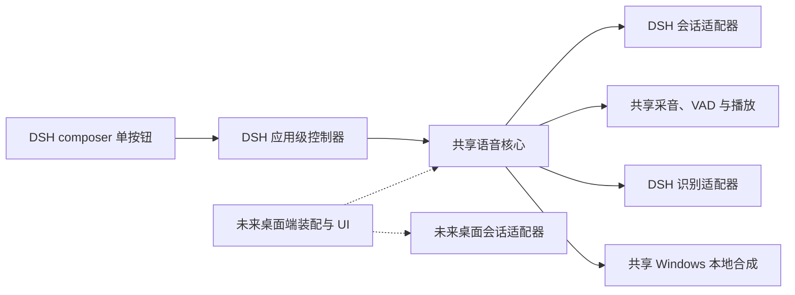

# 连续语音通话接入与维护

本功能当前装配在 Windows x64 本机 DSH 插件中。产品规则见 [单按钮通话设计](windows-voice-call-design-v3.md)，端口约束见 [技术方案](voice-call-technical-v2.md) 和 [实现契约](../core/modules/voice/CONTRACT.md)。未来桌面端替换装配与会话适配器，继续复用语音核心、音频处理和 Windows 合成实现。

2026-11-15 最新目标见[通话设计 v4](windows-voice-call-design-v4.md)与[技术方案 v3](voice-call-technical-v3.md)：仅通话时播报，并要求通用长任务并行对话和扬声器插话。普通 Send 自动启用输出的入口已纠正；插入、后台任务和扬声器双讲仍属于待实施的新目标，不能据旧验收声称已经支持。



虚线部分尚未实现。会话引用是可复制的值对象；每个通话另有稳定 `scopeId`，随 retain、follow、投递和 release 传递，不能用 JavaScript 对象地址区分旧新通话。

## 使用入口与效果

未开启通话时，composer 文字发送仅进行文字对话，不开启麦克风或播报连接。开启通话后，文字输入与语音输入的新增回复都可由当前通话订阅播报；历史消息不重播。

在大肥鱼对话界面点击发送按钮旁边的语音图标。一次点击开始，图标切换；再次点击结束。首次使用自动准备 DSH 识别模型，准备期间也用同一个按钮取消。接通后，说完并停顿会自动识别和发送，助手完成回复后自动播报，无须逐轮点击停止或发送。

默认静音断句为 1200 ms。扬声器默认轮流说话：播报时暂停处理输入，结束后自动恢复。底层配置和端口仍支持耳机模式与断句选项，DSH 界面不再展示设置面板。扬声器全双工尚未开放。

DSH 界面只有这一个语音按钮，没有通话条、静音、独立播报开关、重播或待处理操作面板。错误通过聊天页面已有轻提示呈现；已经接收的内容不会因模型执行失败自动重发。重置大肥鱼会话先结束旧通话，再切换目标。会话须已选择可用的 DSH 对话模型。

DSH 普通文字发送不得调用 `controller.prepareReplyAudio()`。核心的 `inputEnabled:false` 保留为内部可组合能力，不构成 DSH 自动播报的产品入口。按钮仍显式控制持续收音通话；结束、重置和卸载停止本次音频。

## DSH 装配入口

按钮绑定入口是 `createVoiceComposerControl`。实际页面已有 `#voice-button`，位于输入框与发送按钮之间；无需创建语音面板。

```js
import { createVoiceComposerControl } from '../ui/voice/composer.js'
const view = createVoiceComposerControl({
  button: root.querySelector('#voice-button'),
  chat: chatBridge,
  toast: showExistingToast,
})
// 页面离开只执行 view.dispose()，不挂断应用级通话。
```

| 参数 | 类型 | 必需 | 职责 |
| --- | --- | --- | --- |
| `button` | HTMLButtonElement | 是 | 现有 composer 内的 type=button 元素 |
| `chat` | 对象 | 是 | 提供 `onVoiceController(listener)` 的大肥鱼会话桥 |
| `toast` | 函数 | 否 | 复用原聊天页错误轻提示，不创建额外语音 UI |

控制器快照额外提供 `startupPending`，使页面重新挂载后仍能取消准备中的启动。按钮从 `call.status` 和这一字段计算图标、可访问名称与 `aria-pressed`；错误提示按输入身份与错误码去重。

应用级入口为 `app/dsh/client/voice/bootstrap.js` 的 `createVoiceOverlay(ctx, chat, routes)`，由构建器注册至 `shell.overlay` 作为无界面的控制器所有者。composer 从会话桥取得控制器并订阅；视图切换不结束通话，插件卸载释放服务。装配生命周期入口时：

```js
import { createVoiceOverlay } from '../client/voice/bootstrap.js'
const Overlay = createVoiceOverlay(ctx, chatBridge, resources.routes)
// 在 DSH 的 shell.overlay 槽中注册 Overlay。
```

| 参数 | 必需 | 来源与语义 |
| --- | --- | --- |
| `ctx` | 是 | DSH Client 的 Cordis 上下文；可选 Speech Remote 必须经注入作用域访问 |
| `chatBridge` | 是 | `build.mjs` 创建的会话桥；提供严格目标、独立 retain、键盘输入观察和重置屏障 |
| `routes` | 是 | 资源模块生成的路由投影，不自行拼装 Host 端点 |

DSH 对接代码只在 `app/dsh/` 中解释 Session 身份、接收证据、历史基线、事件替换和回复来源。语音绕过表单发送，不改写键盘草稿，也不使用演示回复降级。

## 桌面端复用入口

使用纯 ESM 核心，注入平台和应用端口；不要把 DSH 的 `ctx`、Remote、`rpcId` 或 DOM 传入核心。

```js
import { createVoiceService, DEFAULT_VOICE_CONFIG } from '../core/modules/voice/index.js'

const voice = createVoiceService({
  capture, recognition, conversation, synthesis, playback,
  ownership, audio, clock, ids, config: DEFAULT_VOICE_CONFIG,
})

startButton.onclick = () => {
  const unlock = playback.unlock() // 必须在用户点击栈中执行
  void unlock.then(unlockResult => voice.start(target, { unlockResult, selection }))
}
const unsubscribe = voice.subscribe(renderCallBar)
// 会话重置：await voice.hangup() 后再切换目标，保留旧输入与短期核对。
// 应用退出：await voice.dispose()，再释放装配层资源。
```

输入形状：

```js
const target = {
  runtimeId: 'desktop:runtime-generation',
  conversationId: 'opaque-conversation-id',
  bindingRevision: '1',
}
// selection 是 recognition 端口在能力检查中提供、于通话开始固定的选择。
```

| 参数 | 类型 | 必需 | 职责 |
| --- | --- | --- | --- |
| `capture` | 对象 | 是 | 16 kHz 采样时钟、VAD 事件、切片和停止 |
| `recognition` | 对象 | 是 | 能力检查和完整片段转写 |
| `conversation` | 对象 | 是 | 目标校验、独立引用、投递、接收核对和规范化事件 |
| `synthesis` | 对象 | 是 | 文本合成、不直接控制播放设备 |
| `playback` | 对象 | 是 | 用户手势解锁、播放、可等待的停止和释放 |
| `ownership` | 对象 | 是 | 单通话所有权、续租和释放 |
| `audio` | 对象 | 是 | 音频句柄、引用和共享内存预算 |
| `clock` | 对象 | 是 | 单调时钟及定时器 |
| `ids` | 对象 | 是 | `createId(kind)` 生成稳定操作身份 |
| `config` | 对象 | 否 | 经版本校验的语音偏好；默认见核心配置模块 |

每个方法和事件的准确字段见 [实现契约](../core/modules/voice/CONTRACT.md)。`unknown` 不能当作失败自动重试；取消本地等待也不代表宿主未接收。

## 音频、资源与部署

`app/shared/audio/index.js` 导出音频存储、WAV、重采样、Web Capture、Silero VAD 和播放实现。Windows TTS 由 `app/shared/platform/index.js` 选择实现，使用常驻的本地 System.Speech 辅助进程。

Worker、AudioWorklet、Silero 模型、ORT JavaScript / MJS / WASM 作为固定资源随插件打包。Host 验证清单的长度和 SHA-256；已验证内容按不可变键缓存。修改 Worker 或 Worklet 后必须同步 `app/shared/audio/web/assets/manifest.json` 的长度、摘要和键，再构建。第三方来源与许可证见同目录 `THIRD_PARTY_NOTICES.md`。

```powershell
npm ci
npm run build
npm run test:voice
npm run test:voice:model
npm run test:resources
npm run test:platform
npm pack --dry-run
```

可给模型测试指定自行合成的真实语音 WAV，验证正向人声检测：

```powershell
$env:VOICE_VAD_FIXTURE = 'C:\absolute\path\speech-16k-mono-pcm16.wav'
npm run test:voice:model
```

构建产物更新后须完整重启 DSH Host / 桌面壳，使启动注入清单与文件版本一致。直接刷新仍持有旧注入版本的桌面页面不足以验证升级。

## 排错和验收边界

缺少 Speech Remote、识别模型未准备好、麦克风拒绝、VAD 启动失败必须作为通话能力或通话错误显示，不能使整个插件加载失败。重置、取消启动和卸载后，应检查音轨、Worker、播放、租约及会话引用均释放。

`test:voice` 的二十轮核心测试使用替身端口；它验证排序与释放，不等于二十轮真实 DSH 自动对话。生成 Client 的启动测试验证 Cordis 作用域、覆盖层挂载和资源完整性，也不能替代真实浏览器。发布验收须另行记录实际版本、连续自动输入、真实 ASR、Session 接收、实际回复及 TTS 播放证据，以及长时间运行结果。
