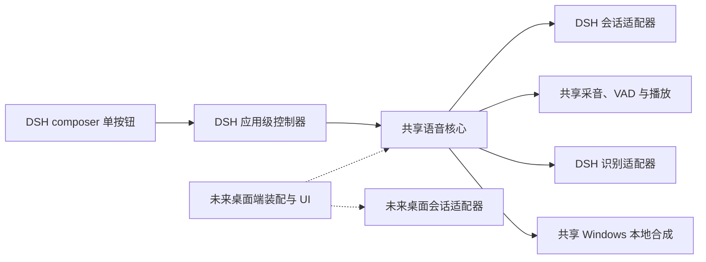

# 连续语音通话接入与维护

本功能当前装配在 Windows x64 本机 DSH 插件中。产品规则见 [通话设计 v4](windows-voice-call-design-v4.md)，端口约束见 [技术方案 v3](voice-call-technical-v3.md) 和 [实现契约](../core/modules/voice/CONTRACT.md)。未来桌面端替换装配与会话适配器，继续复用语音核心、任务生命周期、音频处理和 Windows 合成实现。

2026-11-15 已接入连续输入、按已提交片段播报、条件插入与持久化后台任务。隔离 DSH 验证和实际设备资格分别记录于[本轮验证记录](voice-call-validation-2026-11-15.md)。HECATE 实物双讲尚未验收，浏览器 AEC 设置和合成输入测试不能替代该验收。



虚线部分尚未实现。会话引用是可复制的值对象；每个通话另有稳定 `scopeId`，随 retain、follow、投递和 release 传递，不能用 JavaScript 对象地址区分旧新通话。

## 使用入口与效果

未开启通话时，composer 文字发送仅进行文字对话，不开启麦克风或播报连接。开启通话后，文字输入与语音输入的新增回复都可由当前通话订阅播报；历史消息不重播。

在大肥鱼对话界面点击发送按钮旁边的语音图标。一次点击开始，图标切换；再次点击结束。首次使用自动准备 DSH 识别模型，准备期间也用同一个按钮取消。接通后，说完并停顿会自动识别和发送；助手提交文字片段后即可自动播报，无须等整个长任务结束，也无须逐轮点击停止或发送。

默认静音断句为 1200 ms。DSH 默认使用 `speaker-duplex`：播报时保持采样、AEC 与 VAD，检测到新的人声便停止旧播报。开启前检查音轨实际启用了回声消除，设备变化或采音故障会结束通话。该能力检查不等于具体扬声器与麦克风组合通过声学验收；当前仅有合成音频输入的链路证据。底层仍支持耳机配置与断句选项，DSH 界面保持一个按钮。

DSH 界面只有这一个语音按钮，没有通话条、静音、独立播报开关、重播或待处理操作面板。错误通过聊天页面已有轻提示呈现；已经接收的内容不会因模型执行失败自动重发。重置大肥鱼会话先结束旧通话，再切换目标。会话须已选择可用的 DSH 对话模型。

DSH 普通文字发送不得调用 `controller.prepareReplyAudio()`。核心的 `inputEnabled:false` 保留为内部可组合能力，不构成 DSH 自动播报的产品入口。按钮仍显式控制持续收音通话；结束、重置和卸载停止本次音频。

## DSH 装配入口

按钮绑定入口是 `createVoiceComposerControl`。实际页面已有 `#voice-button`，位于输入框与发送按钮之间；无需创建语音面板。

```js
import { createVoiceComposerControl } from '../ui/voice/composer.js'
const view = createVoiceComposerControl({
  button: root.querySelector('#voice-button'),
  chat: chatBridge,
  toast: showExistingToast,
})
// 页面离开只执行 view.dispose()，不挂断应用级通话。
```

| 参数 | 类型 | 必需 | 职责 |
| --- | --- | --- | --- |
| `button` | HTMLButtonElement | 是 | 现有 composer 内的 type=button 元素 |
| `chat` | 对象 | 是 | 提供 `onVoiceController(listener)` 的大肥鱼会话桥 |
| `toast` | 函数 | 否 | 复用原聊天页错误轻提示，不创建额外语音 UI |

控制器快照额外提供 `startupPending`，使页面重新挂载后仍能取消准备中的启动。按钮从 `call.status` 和这一字段计算图标、可访问名称与 `aria-pressed`；错误提示按输入身份与错误码去重。

应用级入口为 `app/dsh/client/voice/bootstrap.js` 的 `createVoiceOverlay(ctx, chat, routes)`，由构建器注册至 `shell.overlay` 作为无界面的控制器所有者。composer 从会话桥取得控制器并订阅；视图切换不结束通话，插件卸载释放服务。装配生命周期入口时：

```js
import { createVoiceOverlay } from '../client/voice/bootstrap.js'
const Overlay = createVoiceOverlay(ctx, chatBridge, resources.routes)
// 在 DSH 的 shell.overlay 槽中注册 Overlay。
```

| 参数 | 必需 | 来源与语义 |
| --- | --- | --- |
| `ctx` | 是 | DSH Client 的 Cordis 上下文；可选 Speech Remote 必须经注入作用域访问 |
| `chatBridge` | 是 | `build.mjs` 创建的会话桥；提供严格目标、独立 retain、键盘输入观察和重置屏障 |
| `routes` | 是 | 资源模块生成的路由投影，不自行拼装 Host 端点 |

DSH 对接代码只在 `app/dsh/` 中解释 Session 身份、接收证据、历史基线、事件替换和回复来源。语音绕过表单发送，不改写键盘草稿，也不使用演示回复降级。

文字与语音都用稳定 requestId 进行 `steer`。旧生成正在运行时，Host 核对 generation、输入仍在 inbox 且未 claim 后才条件中断；在旧 driver 收尾后用无正文 wake 唤醒。已进入工具执行或证据不完整时不盲目取消。中断回执丢失仅查询原 interruptionId，不重新发送正文或重复中断。DSH 完整 persona 的电话策略写入原有 modules 变量，使后台任务收到句柄后立即回到聊天。

## 后台任务接入

通话中的长操作应通过 `fish_task_start` 返回持久任务句柄；后续使用 `fish_task_list`、`fish_task_inspect` 和 `fish_task_cancel`。取消先读取最新版本，传入 `expectedVersion`；版本冲突先重新核对。启动 operationId 由 Host 根据实际 tool call 生成，模型传入 operationId 时只允许核对已有操作，不创建新操作。取消通话不调用这些任务取消方法。

`fish_task_inspect({taskId,afterVersion,limit})` 的事件默认 50 条，最大 100 条；继续读取时把最后一条事件的 version 作为新的 afterVersion。查询当前快照不需要读完历史。

```js
// 模型工具调用示例：立即返回 {ok:true, task:{taskId,version,status}}。
fish_task_start({
  toolName: 'pwsh',
  arguments: { description: 'Wait briefly and print a completion result', command: 'Start-Sleep -Seconds 5; Write-Output done' },
})
// 先 inspect(taskId)，再按查到的版本请求取消。
fish_task_cancel({ taskId, expectedVersion })
```

| 适配路径 | 实际行为 | 边界 |
| --- | --- | --- |
| `dsh-pwsh-job` | 强制原生 background，观察/停止 DSH job，按原 callId 恢复句柄 | 依赖该 DSH 版本 jobs API 与 pwsh schema |
| `mcp-polling` | 同一 MCP server 的 requestId/start/status/cancel 协议 | 默认覆盖已有全部 farm-task 操作，不是单独的锄地特例；其他协议须登记 descriptor |
| `dsh-tool` | 显式登记工具能力、资源键和完成范围 | 未登记工具不会自动被视为可后台化、可取消 |
| 自定义 adapter | 注入 execute/watch/cancel/recover 与资源推导 | 必须明确何种证据能证明外部已终止 |

默认 farm-task descriptor 使用保守的共享世界资源键，两个 MCP server 别名也不会绕过互斥。状态查询中的 stale/no_state/unacknowledged 不表示已停止。没有确定终态的任务保持 `outcome-unknown` 和资源隔离，不能自动重放启动。

DSH Host 的扩展参数为 `chonkyfishTaskToolCapabilities`、`chonkyfishTaskProtocols` 和 `chonkyfishTaskAdapters`。通话前台只允许明确安全的短查询、任务控制和后台上下文；长等待或未经批准的工具会收到转后台的说明。仅声明工具名字不会获得受管理执行资格。

工具的完成范围由可信 Host capability 在启动前确定并持久化；返回一个异步句柄不等于业务完成。任务存储必须原子提交取消操作与停止意图，不能先写回执再单独改状态。桌面端适配方法与完整存储要求见[任务核心契约](../core/modules/tasks/CONTRACT.md)。

跨宿主复用时直接注入存储与业务 adapter：

```js
import { createTaskService } from '../core/modules/tasks/service.js'
const tasks = createTaskService({ repository, adapters: { remoteJob }, onEvent })
const receipt = await tasks.start({
  owner: { namespaceId, conversationId }, operationId, sourceInputId,
  adapter: 'remoteJob', command: { name: 'operation', args: {} },
})
```

| 注入参数 | 类型 | 必需 | 职责 |
| --- | --- | --- | --- |
| `repository` | 对象 | 是 | 原子入账、操作核对、版本、资源锁与通知 outbox |
| `adapters` | 名称到对象的映射 | 是 | `deriveResources/execute`，外部任务还需 `watch/cancel/recover` |
| `onEvent` | 异步函数 | 否 | 成功持久接收才返回 `{acknowledged:true}`；失败由退避重试 |
| `now` / `uuid` | 函数 | 否 | 可替换时钟和任务身份生成器 |

完成通知保存原 `namespaceId/conversationId/sourceInputId`，只能回原 owner。桥接使用稳定 eventId 去重，消息持久化后才确认 outbox。原会话不在时保留待送事件，不创建或重绑到新会话。任务语音低于用户输入优先级。

## 桌面端复用入口

使用纯 ESM 核心，注入平台和应用端口；不要把 DSH 的 `ctx`、Remote、`rpcId` 或 DOM 传入核心。

```js
import { createVoiceService, DEFAULT_VOICE_CONFIG } from '../core/modules/voice/index.js'

const voice = createVoiceService({
  capture, recognition, conversation, synthesis, playback,
  ownership, audio, clock, ids, config: DEFAULT_VOICE_CONFIG,
})

startButton.onclick = () => {
  const unlock = playback.unlock() // 必须在用户点击栈中执行
  void unlock.then(unlockResult => voice.start(target, { unlockResult, selection }))
}
const unsubscribe = voice.subscribe(renderCallBar)
// 会话重置：await voice.hangup() 后再切换目标，保留旧输入与短期核对。
// 应用退出：await voice.dispose()，再释放装配层资源。
```

输入形状：

```js
const target = {
  runtimeId: 'desktop:runtime-generation',
  conversationId: 'opaque-conversation-id',
  bindingRevision: '1',
}
// selection 是 recognition 端口在能力检查中提供、于通话开始固定的选择。
```

| 参数 | 类型 | 必需 | 职责 |
| --- | --- | --- | --- |
| `capture` | 对象 | 是 | 16 kHz 采样时钟、VAD 事件、切片和停止 |
| `recognition` | 对象 | 是 | 能力检查和完整片段转写 |
| `conversation` | 对象 | 是 | 目标校验、独立引用、投递、接收核对和规范化事件 |
| `synthesis` | 对象 | 是 | 文本合成、不直接控制播放设备 |
| `playback` | 对象 | 是 | 用户手势解锁、播放、可等待的停止和释放 |
| `ownership` | 对象 | 是 | 单通话所有权、续租和释放 |
| `audio` | 对象 | 是 | 音频句柄、引用和共享内存预算 |
| `clock` | 对象 | 是 | 单调时钟及定时器 |
| `ids` | 对象 | 是 | `createId(kind)` 生成稳定操作身份 |
| `config` | 对象 | 否 | 经版本校验的语音偏好；默认见核心配置模块 |

每个方法和事件的准确字段见 [实现契约](../core/modules/voice/CONTRACT.md)。`unknown` 不能当作失败自动重试；取消本地等待也不代表宿主未接收。

## 音频、资源与部署

`app/shared/audio/index.js` 导出音频存储、WAV、重采样、Web Capture、Silero VAD 和播放实现。Windows TTS 由 `app/shared/platform/index.js` 选择实现，使用常驻的本地 System.Speech 辅助进程。

Worker、AudioWorklet、Silero 模型、ORT JavaScript / MJS / WASM 作为固定资源随插件打包。Host 验证清单的长度和 SHA-256；已验证内容按不可变键缓存。修改 Worker 或 Worklet 后必须同步 `app/shared/audio/web/assets/manifest.json` 的长度、摘要和键，再构建。第三方来源与许可证见同目录 `THIRD_PARTY_NOTICES.md`。

```powershell
npm ci
npm run build
npm run test:voice
npm run test:tasks
npm run test:voice:model
npm run test:resources
npm run test:platform
npm pack --dry-run
```

可给模型测试指定自行合成的真实语音 WAV，验证正向人声检测：

```powershell
$env:VOICE_VAD_FIXTURE = 'C:\absolute\path\speech-16k-mono-pcm16.wav'
npm run test:voice:model
```

构建产物更新后须完整重启 DSH Host / 桌面壳，使启动注入清单与文件版本一致。直接刷新仍持有旧注入版本的桌面页面不足以验证升级。

## 排错和验收边界

缺少 Speech Remote、识别模型未准备好、麦克风拒绝、VAD 启动失败必须作为通话能力或通话错误显示，不能使整个插件加载失败。重置、取消启动和卸载后，应检查音轨、Worker、播放、租约及会话引用均释放。

`test:voice` 的二十轮核心测试使用替身端口；它验证排序与释放，不等于二十轮真实 DSH 自动对话。生成 Client 的启动测试验证 Cordis 作用域、覆盖层挂载和资源完整性，也不能替代真实浏览器。发布验收须另行记录实际版本、连续自动输入、真实 ASR、Session 接收、实际回复及 TTS 播放证据，以及长时间运行结果。
