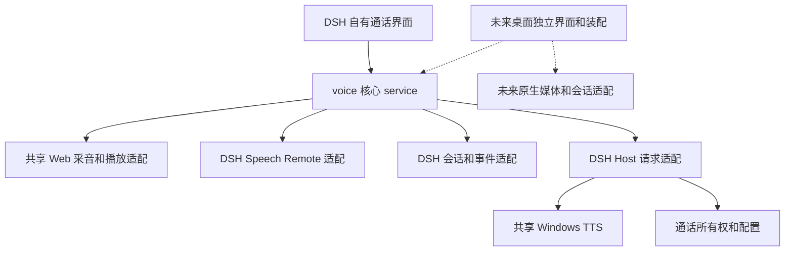

# 大肥鱼连续语音通话技术方案 v2 · DSH 插件实施与桌面端扩展

- 日期：2026-11-14；仓库基线 `3b5cd09`，插件版本 `0.4.10`。
- 状态：已按单按钮 v3 实施并完成本次 DSH 验收。本文规定目标与接口；实际入口见[接入说明](voice-call-implementation-guide.md)，具体证据与未覆盖场景见[验收记录](voice-call-validation-2026-11-14.md)。
- 产品依据：[单按钮通话设计 v3](windows-voice-call-design-v3.md)。本方案替代[技术方案 v1](windows-voice-call-technical-v1.md)，保留其连续自动发送与自动播报目标；下文涉及旧通话条的 UI 规划由 v3 替代，核心与适配契约继续有效。
- 架构依据：[项目架构调整设计](architecture-refactoring-design-v1.md)：共享核心业务与非 UI 技术实现，三个应用分别拥有 UI，不提前创建桌面空应用。
- 自审：[技术方案 v2 review](voice-call-technical-review-v2.md)。

2026-11-15 更新：最新需求与改造方案见[通话设计 v4](windows-voice-call-design-v4.md)和[技术方案 v3](voice-call-technical-v3.md)。本文的等待 turn 结束、整轮完成后播报和扬声器轮流规则属于旧实现，不能满足本轮“做事时随时对话与打断”的完整要求。

## 1. 本次交付与架构决策

当前唯一实施端是 **Windows x64、本机 DSH 桌面宿主中的大肥鱼插件**。一次开启后持续采音、自动断句、识别与投递，助手完成回复后自动播报；收音不因上一条识别或 DSH 任务运行而停止。耳机主路径支持插话停播，扬声器默认自动轮流，实测通过后才允许全双工。

未来 Windows、macOS 桌面端复用语音领域规则与端口契约，各自实现应用装配、会话运行时和音频设备适配；本次不选择桌面 UI 框架、不实现新 Agent Loop、不创建 `app/windows/`、`app/macos/` 占位目录。

确定以下边界：

1. **语音核心**负责轮次、顺序、状态、取消范围、回复过期、队列预算和故障策略，采用可在浏览器或后台 JS 运行时执行的 ESM；不依赖 DOM、Node 内建模块、HTTP、DSH、系统音色 API。
2. **DSH 适配器**负责 Session 身份、接收证明、原始事件与 Speech Remote 映射；核心看不到 `ctx`、`rpcId`、preset、surfaceOp 等宿主字段。
3. **非 UI 音频实现**负责采样、重采样、VAD 推理、音频缓冲、编码与播放；可复用的浏览器实现放 `app/shared/audio/web/`。DSH 通话条、React/Shadow DOM、按钮与焦点状态仍归 DSH UI。
4. **平台语音实现**负责 Windows 本地合成与子进程；归 `app/shared/platform/voice/`，不归未来 Windows APP，也不依赖 DSH home 或路由。
5. **装配入口**注入能力并持有生命周期。DSH 中核心运行在插件 Client，Host 只提供系统合成、偏好和通话所有权，不再运行第二套语音决策器。

“运行宿主”与“操作系统”分别选择。例如 DSH-on-Windows 使用 DSH 会话适配器和 Windows TTS；未来 Windows 桌面使用自己的会话适配器，仍可使用同一 Windows TTS。不能在核心里写 `isDSH` 或 `isWindows` 分支。

## 2. 已核对的当前实现与修正点

| 源码 | 事实 | 实施要求 |
| --- | --- | --- |
| [runtime.js](../app/dsh/ui/runtime.js) | 表单发送忙时直接返回并清草稿；真实发送失败后有 sendDemo 降级 | 语音使用独立投递用例；不调用表单、不退回假回复 |
| [build.mjs](../app/dsh/build.mjs) 的 createFishChat | ensure 可回退最近工作区；send 只检查 prompt 的 ok；render 列表丢弃身份 | 暴露严格目标校验及原始事件端口；语音禁止工作区回退 |
| 同一构建文件 | 插件 apply 持有唯一 chatBridge；现有 shell.overlay 可跨页面 | 在同一生命周期装配核心与全局通话条，路由卸载只释放视图 |
| [social/policy.js](../core/modules/social/policy.js) | 外部消息也可能是 source.kind=user，使用 Host 分配的 social-id 识别 | 来源分类在 DSH 适配器复用现有判定，禁止核心猜渠道 |
| [resources/index.js](../app/shared/resources/index.js) | 已有配置串行写链、expectedRevision 检查与迁移写屏障 | voice 纳入现有 sanitize / merge / CAS，不另建竞争写入口 |
| [migration/http.js](../app/dsh/adapters/migration/http.js) | 已使用 ctx.connection.requestRejection 对接宿主认证 | 新 voice Host 路由采用同一认证接入，不把“无插件私有 token”写成“无宿主认证” |
| [平台入口](../app/shared/platform/index.js) | 文件系统只分 posix/win32，但原生能力还需 os/arch | TTS 新增单独能力选择，不能因 posix 就假定 macOS 语音可用 |

上游以 `39163dd30f703a79079e2d2446545cff3c453738` 为核对基线：[Speech Remote](https://github.com/deepseek-ai/deepseek-harness/blob/39163dd30f703a79079e2d2446545cff3c453738/packages/experimental/api-speech-to-text/src/index.ts)、[挂载实现](https://github.com/deepseek-ai/deepseek-harness/blob/39163dd30f703a79079e2d2446545cff3c453738/packages/experimental/client-ui-voice-input/src/client/mount.ts)、[WAV 校验](https://github.com/deepseek-ai/deepseek-harness/blob/39163dd30f703a79079e2d2446545cff3c453738/packages/experimental/speech-to-text/src/wave.ts)、[Session 契约](https://github.com/deepseek-ai/deepseek-harness/blob/39163dd30f703a79079e2d2446545cff3c453738/packages/api/session-controller/src/client/contract/session.ts)。已有源码核对不等于当前安装版本兼容；阶段 A 必须对实际版本验证。

DSH Speech 接受完整录音，不提供连续监听、自动发送或 TTS。Session 支持 beginSubmission 生成 requestId，再作为 prompt 第四参；成功值为 `{accepted:true}`。这些事实只存在适配器与兼容性报告中，不能成为共享领域模型。

## 3. 目录、依赖与构建边界

以下为方案规划的职责结构；实际文件拆分与端口以[实现契约](../core/modules/voice/CONTRACT.md)为准，不为规划名称创建空模块：

```text
core/modules/voice/
  contracts.js           DTO、事件、错误与端口语义；本模块内部公共边界
  service.js             单实例用例与串行事件处理
  turns.js               人声/静音 → 音频轮次与切块决策
  delivery.js            排序、接收状态与核对策略
  replies.js             归属、过期、播报资格与打断
  speech-text.js         正文到可朗读文本的纯转换
  config.js, limits.js   策略校验、默认值与预算
  tests/                 核心状态与端口契约测试
app/shared/audio/
  clips.js               非 UI 的内存音频句柄、引用与预算实现
  wav.js, resample.js     编解码、校验及有状态重采样
  web/
    capture.js, playback.js, vad.js
    capture.worklet.js, vad.worker.js
    assets/              锁定版本的 VAD 模型与 WASM 运行时
app/shared/platform/voice/
  windows-tts.js, windows-tts.ps1
app/dsh/adapters/voice/
  speech.js, conversation.js, host.js, http.js
app/dsh/client/voice/
  bootstrap.js           Client 装配、Remote 观察、Host 请求与释放
app/dsh/ui/voice/
  bar.js, settings.js    仅 DSH 界面、可访问性和交互状态
```

端口暂留模块内部，不为一个语音模块建立全项目通用服务总线。`core` 不 import `app`；`app/shared` 不 import `app/dsh`；UI 只调用 service 用例和读取业务快照。不能在 shared 放共享 UI、hooks 或带导航行为的 ViewModel。

在现有 `build.mjs` 中增加语音 ESM 的模块打包步骤，再嵌入客户端入口；不能把含 import 的源码直接拼进原有函数字符串。核心源码只有一份，Host 不重复嵌入决策器。Worklet、Worker、模型与 WASM 独立生成带内容哈希的资源清单，Host 以白名单映射到同源静态资源；URL 不接受任意路径。

WASM 首版用单线程路径，不要求 SharedArrayBuffer 或修改 DSH 全局 COOP/COEP。禁止运行时 CDN；必须在真实 DSH CSP、MIME、Worker 与 AudioWorklet 加载环境验证。`package.json.files` 同步包含 `app/dsh/client/**` 和生成资源；当前已有的 `app/shared/**` 覆盖共享音频实现。构建与 npm pack 内容检查共同防止本地可运行、安装后缺文件。

## 4. 当前与未来的装配拓扑



DSH 麦克风和实际播放都属于 Client；SenseVoice 与 Windows TTS 属于 Host。首版能力报告须确认本机 Windows Host/Client 组合，不能仅凭浏览器 User-Agent 判断。远程 Host 或另一个操作系统返回 unsupported，不自动在错误机器准备模型、合成或播放。

未来桌面端将 service 放在应用拥有的后台 JS 运行时，UI 通过本地 IPC 调用用例与订阅快照；原生媒体适配在设备所在进程执行。后台运行时可以是独立进程或嵌入 JS 引擎，本次不锁定 Electron/Tauri。若未来选择完全不运行 JS 的原生实现，需要另行评估核心承载，不能宣称 JS 模块可直接被原生调用。

| 能力 | 当前 DSH Windows | 未来 Windows 桌面 | 未来 macOS 桌面 |
| --- | --- | --- | --- |
| 轮次、顺序、打断、预算、过期 | 同一 core/voice | 复用同一核心 | 复用同一核心 |
| 设备采音 / VAD / 播放 | 共享 Web 适配 | 可复用 Web 或原生适配 | 原生或 Web 适配 |
| ASR | DSH Speech Remote | 本地提供方适配，不依赖 DSH | 本地提供方适配，不依赖 DSH |
| 会话与回复事件 | DSH conversation adapter | 桌面自身会话运行时适配 | 桌面自身会话运行时适配 |
| TTS | 共享 Windows helper | 可复用同一 helper，或兼容的原生实现 | 新平台 TTS 适配 |
| 所有权 / 配置 / 生命周期 | DSH Host + Client 装配 | 应用后台装配 | 应用后台装配 |
| 页面、设置、托盘、权限引导 | DSH UI | 独立 UI | 独立 UI |

语音模块不拥有模型推理循环、工具执行、人格或聊天历史库。未来桌面必须另外提供会话运行时；仅把 Speech Remote 换成本地识别器并不能使整个大肥鱼脱离 DSH。

## 5. 核心数据与端口契约

以下为设计中的 JavaScript 数据契约；`schemaVersion` 表示模块契约版本，与 DSH 版本独立。跨进程 DTO 只传可序列化值，AbortSignal、DSH binding、音频轨道和平台对象不能跨线。

```text
ConversationRef = { runtimeId, conversationId, bindingRevision }
CallRef         = { callId, conversation: ConversationRef, generation }
InputTurn       = { inputId, order, replyEpoch, clips[], transcript?, admission }
Admission       = not_attempted | submitting | accepted | rejected | unknown
AudioClipRef    = { scopeId, clipId, format, sampleCount, byteLength }
VoiceFailure    = { code, stage, retryable, outcome, operationId? }
outcome         = not_applied | applied | unknown
```

runtimeId、conversationId、bindingRevision 均由适配器提供为不透明字符串，核心只比较相等性。DSH 的 SessionId、source.rpcId 映射成目标和提交身份；未来桌面可用自己的 ID。音频 ref 是当前应用音频仓储的作用域句柄，不是文件路径或可传给另一进程直接解引用的地址。

| 端口 | 最小操作 | 必须保证的语义 |
| --- | --- | --- |
| Capture | inspect / start / openTurn / cut / gate / stop / release | 16 kHz 单声道 PCM16 片段；采样序号与活动事件；持续采音和有界缓冲；stop 幂等 |
| Recognition | inspect / transcribe(clipRef, selection, operation) | 返回最终文本；具体提供方在开始时固定；取消后晚到结果仍需代号过滤 |
| Conversation | inspect / prepareSubmission / submit / inspectAdmission / follow | 显式目标、稳定提交身份、接收证明、真实输入消费与最终回复事件 |
| Synthesis | inspect / synthesize(text, voice, operation) / release | 输出有界、可校验的音频句柄；合成完成不表示播放 |
| Playback | inspect / unlock / play / stop | 实际 started/ended/failed 回调；stop 立即停止本客户端声音且不等待远程合成 |
| Ownership | acquire / renew / release | 明确音频环境作用域、目标、owner、租期和服务代号；旧 owner 不能续租或释放新 owner |
| Preferences | read / patch(expectedRevision) | 策略与偏好通过同一个串行/CAS 写入口更新；不存通话运行态 |
| clock / ids | monoNow / schedule / cancel / createId | 超时用单调时间；音频断句用采样时间；测试可注入 |

operation 是 `{operationId, generation}` 加当前进程内的取消信号；跨进程适配器映射为显式 cancel 消息。端口不得将 transport abort 等价成副作用已撤回。

retryable 表示允许用户显式重试，不表示可自动重放；unknown 提交必须先走核对流程。对 inspect/follow 等无业务副作用的观察可有界重连，但重连不能自动开启麦克风、重发正文或补播旧回复。

音频仓储由媒体适配器组合注入 Capture、Recognition、Synthesis、Playback。核心持有引用并决定何时释放，但不复制 PCM 或把 base64 放入业务快照；DSH ASR 适配才负责读取 clip、封装 WAV 和 base64。未来 IPC 可传有界二进制块或本地句柄，无需为了复用核心绕一圈 HTTP/base64。

### 5.1 归一化会话事件

Conversation.follow 输出已排序的批次 `{streamGeneration, cursor, reset, events}`；cursor 不透明，不比较其数值、不假定所有宿主都有连续 seq。适配器负责历史与 live 去重、顺序及缺口判断，reset 表示新基线而非“重播历史”。

```text
input.accepted  { submissionId, evidence }
input.consumed  { submissionId, messageId, conversationTurnId, origin }
input.removed   { submissionId, reason }
turn.started   { conversationTurnId }
reply.final    { replyId, conversationTurnId, text, origin, inputSubmissionIds[] }
turn.ended     { conversationTurnId, outcome: completed | cancelled | failed }
stream.reset   { reason, baselineCursor }
```

origin 仅为 `local / autonomous / external / mixed / unknown`。DSH 适配器把 source、social-id、surface 替换、消息正文和成功 turn/end 折叠成上述事件；核心不处理原始 DSH 事件。reply.final 表示正文已定稿，但只有相应成功 turn.ended 后才有自动播报资格。缺 turn 起点、来源、消费身份或终态时不编造事件，进入核对/只显示文字路径。

DSH 适配器在 turn 运行期间折叠消息与 surface 操作；到成功终态后，先输出定稿 reply.final，再输出对应 completed 的 turn.ended。失败或取消仅输出终态，不将中间正文伪装为 final。订阅必须先建立观察和基线，再交付 live；同一捕获屏障内确定 cursor 与运行中 turn，禁止“先 inspect、稍后订阅”漏掉中间事件。Client connected 时建立激活边界，之前已运行的 turn 标为旧 turn。

任何适配器都必须把一次真实输入消费映射到正确 turn，不承诺一条 prompt 对应一个独占 turn。多条本地输入进入同一 turn 时保留全部身份；混合外部输入优先归类 mixed。

## 6. 核心执行、媒体与生命周期

service 维护单一事件队列；所有端口回调只投递事件，不直接修改队列或 UI。纯状态转换产生带 operationId 的副作用，异步执行后再投递结果；不能 await 一次 30 秒识别而阻塞起音、挂断和停播。停播、停止新提交、采音关闭使用高优先级控制路径，不排在长任务后。

运行态拆为 call、capture、各 input、playback 四个维度。调用 `getSnapshot()` 返回只读业务状态；焦点、弹窗、路由与按钮悬停留在 UI。高频采样不进入快照或配置，界面音量为单独的限频测量流。

启动顺序：用户点击时由应用装配层在**同步调用栈内**立即调用 Playback.unlock，随后再异步严格校验 ConversationRef 与能力 → 取得所有权 → 启动媒体及事件观察 → 全部成功后 connected。不能等 inspect/HTTP/事件队列处理完成后才请求浏览器音频解锁。unlock 返回的本地就绪结果由媒体适配器验证，不把 DOM 事件传进 core，也不持久化所谓用户手势凭据；后续能力检查失败时释放此次预热音频资源。

模型准备是用户显式动作，不因页面挂载下载；麦克风权限迟到而 call 已取消时立即 stop 新轨道。任何步骤失败都释放本次已取得资源。未来原生播放适配可报告无需手势，但仍完成同一播放能力检查。

Capture 先将设备实际采样率有状态重采样至 16 kHz，再由 VAD 产生带采样序号的 speech/silence 变化。短词如“好”“不”允许进入识别；不以固定最短时长直接过滤。核心根据采样时间达到 0.8 / 1.2 / 1.8 秒静音后请求 seal，ASR 内部切段不改变聊天轮次。

原始环形缓存至少覆盖 300 ms 起音预录和最大 500 ms VAD 工作积压，首版分配 2 秒；超过允许积压暂停并报告，不静默跳帧。Capture.cut 使用明确的半开采样区间 `[start,end)`，原子固定旧区间、下一采样继续接收；最大块默认 15 秒，实际同时受字节和宿主时长限制。优先在可用静音处分块，硬切时保证样本连续，识别边界准确率仍需实测。

一轮所有块最终成功后才自动提交；块失败只重试该块，不重发其他成功块。90 秒连续发言 seal 成一轮并建立下一轮；只有预算足够才继续。为支持失败、超限和挂断后的本页重试，**一轮被宿主确认接收或用户丢弃前，保留整轮可重建音频**，而非每块转写成功就删原始音频。

## 7. DSH 提交适配与接收状态

严格 inspect 必须验证绑定会话属于 canonical 小鱼塘和 chonkyfish preset，不接受 createFishChat 原有的最近工作区降级。校验在适配层使用现有平台路径语义；核心只接收已验证目标与 bindingRevision。

语音适配器对目标持有独立的 retain 引用，不借用会随页面 reset 释放的 chatBridge 引用；两者观察同一真实 Session，不创建第二个 Agent。reset 先使旧 call 的 bindingRevision 失效，旧在途请求仍可通过自己的引用完成核对。

prepareSubmission 调用已核对版本的 `beginSubmission({mode:'queue',text,attachments:[]})`，返回 submissionId 并建立业务 inputId 的映射；submit 映射到 `session.prompt(content,'queue',signal,requestId)`。身份先于调用持有，不能只依赖没有 messageId 的成功返回值。

接收状态单向演进：同一身份在 inbox、真实用户事件或成功回执中的任一接收证明都可确认为 accepted；先收到证明、后收到网络错误不能回退。明确接收前业务拒绝可记 rejected，其他失败记 unknown。错误码白名单须按实际宿主版本核对，不能把任意 `{ok:false}` 或本地 echo 消失当成“没有接收”。

最多一个 submitting，且最多等待一个本地已接受轮次的真实消费/结束；对应 turn 结束且宿主允许接收后再提交下一条。期间持续采音和识别。键盘仍可直接使用宿主，但同一页面的键盘 prepare/accept 身份也接入 Conversation 适配器，以便输出协调；不能清空或夹带键盘草稿。

unknown 阻塞后续自动提交。inspectAdmission 只能根据同一身份核对原目标的 inbox 和历史；暂时未看到不是未接收证明。核对不足时保留原文让用户显式处理，不自动重发。用户改写或确认重发视为新提交尝试，记录 supersedes 关系；不得复用承载旧正文的身份。旧 unknown 后来被证实接收时仍提示可能重复，不通过文字相似度自动撤销任务。

切换 Session、迁移、Remote 失效或关闭 call 后，取消尚未进入副作用的提交；已经调用的 prompt 只核对原目标，不标成“保证撤回”。成功 accepted 不表示持久化、更不表示助手完成；单独记录 consumed 与 ended 状态。

## 8. 回复资格、打断与回声

核心在首次有效起音为该输入固定 replyEpoch；键盘成功接收也推进 epoch。实际消费的 submissionId 把 epoch 带到 conversationTurnId，多输入 turn 取最新本地输入的 epoch。旧回复到达时不能重新赋最新值；来源 mixed/external/unknown 默认不自动读。

只自动播报通话新基线之后开始、拥有完整归属并成功结束的 turn；当前启动前已运行的 turn 与历史回放跳过。旧 turn 在新起音后立即 suppressed；有活动人声、待识别/待投递/held/unknown 输入时不启动输出。被 supersede 的回复不在队列清空后复活。

耳机模式的有效起音立即 stop 客户端播放并取消旧合成，保留预录，后续语音照常识别；不调用 Agent cancel。主动重播受相同会话、输入忙碌和打断规则约束。关闭回复声音提升输出 generation 并清队列，输入继续；重新打开只接受新的回复。

纯文本朗读转换在 core，过滤代码、工具、思考与隐藏旁白；Markdown 转自然停顿，不再调模型改写。每次自动读最多 800 字，完整正文仍保留；按标点分句且单句最多 120 字。合成一次一句，预取最多两句，不等待整篇合成。

扬声器默认自动轮流：播放前确认没有活动输入，期间 gate 掉识别入口，清掉尾音和 VAD/预录状态，播放结束 400 ms 后再计算是否允许收音。主动 stop 自己管理 gate 结束，不能依赖已经失效的旧 onended；回调只能重新计算允许条件，不能在 mute/挂断后直接开麦。

AEC 请求与设备 settings 不等于本地 TTS 回声已被消除。只有播报无自发用户消息、同时真人插话能完整保留两项实测通过，才允许扬声器全双工；设备变化后撤销该验证。使用文字相似度删除所谓回声会吞掉真人复述，禁止采用。

## 9. Windows TTS、Host API 与通话所有权

Windows TTS 使用独立共享平台适配器：系统 Windows PowerShell 5.1 / System.Speech，枚举 Enabled 音色，普通文本异步合成到内存 WAV。固定入口、参数数组、shell:false、windowsHide:true；文本仅通过 UTF-8 stdin 数据进入，不拼进命令和 SSML。取消需独立命令读取与完成通知，500 ms 未 settled 则回收插件自己的 helper，不关闭宿主共享识别进程。

输出返回 Client 播放，helper 不向系统扬声器发声。Host 校验 WAV 结构、声道、采样率、帧数及长度，Client 预留解码预算再解码。合成超时、音色不存在或策略阻止启动都报告具体能力失败；不改系统策略，不隐式换云端提供方。

拟新增路由在 `core/contracts/spec.js` 声明，由 resources 投影；此处名称是设计，不是现有接口：

| 方法与路由 | 用途 | 关键输入 |
| --- | --- | --- |
| GET /chonkyfish/voice/capabilities | Host 环境与 TTS 能力、契约版本 | 无音频副作用 |
| POST /chonkyfish/voice/calls | acquire / renew / release | action、callId、ownerId、conversationRef、leaseGeneration |
| POST /chonkyfish/voice/synthesis | 合成一句 | callId、租约代号、operationId、voiceId、text、rate |
| POST /chonkyfish/voice/cancel | 取消本次合成 | callId、租约代号、operationId |
| GET /chonkyfish/voice/assets/<key> | 白名单构建资源 | 固定 manifest key |

Host 等待 layoutReady/迁移恢复；初始化、关闭或缺 ctx.connection 认证能力时写路由 fail closed，不假装功能存在。业务请求限同源与 JSON，调用宿主 requestRejection；不新增插件私有 token。合成请求正文限 16 KiB、text 限 120 字符；控制请求限 4 KiB；每个 Host 最多一个合成运行、两个预取请求，使用全局预算防止多目标各自有界但总量无限。

首版按本机 DSH Host 的音频环境提供一个通话槽，acquire/renew/release 在 Host 内串行，记录对应 ConversationRef；不同会话也不能在同一 Host 同时开两路通话。租期 15 秒、5 秒续租，同时只允许一个客户端 owner。服务代号每次 Host 启动都变化，release/renew 必须比较完整代号，旧 owner 不能释放后来 owner。Client 以续租请求开始的本地单调时间计算保守截止值，留 1 秒余量，不直接比较两端绝对时间。

核心只接收不透明 ownershipScope，不把单槽规则写死；未来桌面可按自己的设备与后台进程提供同一端口。本方案不宣称能仲裁另一个独立应用或另一个 DSH Host 进程的物理麦克风占用。

**所有权租约的保证范围**：Host 可强制隔离自己的 TTS 任务与资源；DSH prompt 仍走原 Session API，无法原子携带该租约，所以不宣称对 Session 提交有服务端 fencing。Client 在每次 await 后、实际 submit 前再次检查 generation 和保守租期；失效后停止新采音与提交。过期前已经发出的 RPC 仍可能稍后 accepted，按原身份核对，不自动重发或改目标。

Host 不能强制关闭已冻结窗口的物理麦克风。另一个窗口在旧租期未结束时不能开启；过期后显示旧通话失联，并由用户显式接管，不自动抢占。恢复的旧窗口在处理音频前检查租期，暂停而非重获所有权。若未来需要对会话提交的强 fencing，应在具体 Conversation 后端提供原子校验与接收，属于后端能力升级，不能只增加一个客户端布尔值。

## 10. 配置、资源预算、关闭与恢复

新增 `config.json.voice`，通过现有 resources.updateConfig 串行链与 expectedRevision 更新：

```json
{
  "version": 1,
  "endSilenceMs": 1200,
  "replyAudioEnabled": true,
  "duplexPreference": "headphones",
  "tts": { "providerId": "windows-system-speech", "voiceId": null, "rate": 0 }
}
```

voice 子 schema 的 version 与外层 config version 分别管理。语音业务校验位于 core/voice/config；资源层加入 voice 默认值、字段深合并与验证，避免现有 sanitizeConfig 丢掉新字段。ASR 选择仍由 DSH 自身设置拥有，本插件只在 call 开始时捕获，不复制第二份宿主识别设置。

voice 缺失时使用 v1 默认；已存在但版本高于当前支持时报告 VOICE_CONFIG_UNSUPPORTED，禁止开启通话或用旧版 voice 设置页覆盖。资源层在非 voice 更新时须原样保留这份不支持的 voice 字段，不让 sanitizeConfig 悄悄降级；其余聊天功能仍可使用。实现此分支及 CAS 保留测试后才能宣称版本向前兼容。

设备选择与扬声器全双工验证仅在本次客户端连接内有效，不能把某设备验证复制到另一机器。音色引用含 providerId，换应用或平台后必须重新枚举；失效音色不能假装已恢复。当前偏好存于 DSH resources；未来桌面注入自己的配置端口与数据根目录，不能直接复用包含 DSH_HOME 解析的整个 createResources。

| 资源 / 操作 | 初始上限 | 超限行为 |
| --- | --- | --- |
| 未解决输入轮次 | 8，含 collecting、识别、held、unknown | 在建立下一轮前暂停，已取得轮次保留 |
| 原始音频 | 180 秒 16 kHz mono PCM16，约 5.8 MB | 余 15 秒预警，预算耗尽前 seal 并暂停 |
| 输入侧复制与编码 | 32 MiB | admission 前预留，禁止超额分配 |
| 待发正文 | 总 16000 字符，单轮 4000 | 超额轮次 held，不截断后自动发；可基于保留音频处理 |
| 输出 WAV | 单句 2 MiB / 30 秒；队列 8 MiB | 缩小句子或报告，不无限预合成 |
| 解码 AudioBuffer | 16 MiB | 按帧数和声道提前预留，播放后释放 |
| 总音频工作集 | 64 MiB，含输入、输出与复制，不含模型/运行时 | 暂停预取或采音，不静默丢已接收内容 |
| 转写 / 合成 | 单个执行 30 秒 / 15 秒 | 取消并 held / 声音故障；不用于取消 Agent |
| 无采样 / VAD 落后 | 单调时间 2 秒无新采样 / 500 ms 积压 | 暂停，需显式继续 |

每条 async 任务 admission 前预留最大在途空间。转写调度等待与单次执行分开计时：首版只发一个 ASR RPC，未 admission 的本地块仍占预算但不启动执行超时，等待超过 30 秒显示积压、暂停新采音，不取消或删除已接收块。已发 RPC 的 30 秒含宿主内部排队，不含本地尚未提交的时间。

上述轮次、文本与工作集预算由当前应用实例的音频仓储统一计数，跨 call 保留的 held/unknown 内容同样计入，不能每次新建 call 清零预算。反复挂断和重开之前须检查剩余名额；空间不足时先处理已有未发送内容，不增加隐藏缓冲。

释放原则：accepted 或用户明确丢弃释放整轮原始音频，accepted 后保留必要正文与身份直到消费/核对结束；已处理 turn 用游标和有界最近集合去重，不能无限增长。Host 租约过期、release 或 Client 断线后取消所属合成并清输出，不只删除 owner 记录。

挂断：立即封住新提交 → stop 采音与本地播放 → 尾音和未提交轮次转 held → 取消识别/合成 → 在内存保留原目标未发送区 → 释放媒体、事件观察与所有权。不能为了等 RPC 收尾延迟用户可见挂断。已在途提交保留独立核对记录和原目标引用，不能因结束 call 就丢掉结果证据。

挂断后的核对 drain 最长 30 秒；只保留必要的原目标引用/事件观察，不保留采音、自动投递或播放权限。结束或到期后释放该引用，尚无证据的结果继续显示 unknown；以后用户显式核对时按原 ConversationRef 重新取得短期引用。未知记录也计入 8 轮名额，不能靠无限 drain 维持旧 Session。插件卸载立即取消全部观察和引用，不等 30 秒，也不宣称未决请求已撤回。

mute 释放采音，将未提交轮次 held，已有输出仍可用；声音关闭只停输出，输入继续。reset 先结束旧 call，再改变会话绑定。callId、音频、待发正文、connected 不落盘，不随重启恢复麦克风；界面仍可在本次进程内查看原目标未发送内容。

窗口失焦不停止；插件切页只卸载视图。最小化时以实际采样/AudioContext 状态确认仍在运行。休眠、锁屏导致采样不可证实、设备变化、Remote 断线或租约失效时暂停；恢复需用户继续并建立新媒体 generation 与事件基线。迁移独占阶段撤销 Host lease、停止合成并通知 Client 暂停，偏好写入走既有屏障；通知到达前已发的 prompt 仍属于在途结果，不宣称迁移能原子撤回 DSH 任务。

## 11. 桌面迁移步骤与兼容演进

桌面项目启动时按以下顺序扩展，不复制 DSH Client 作为桌面核心：

1. 为桌面自身会话运行时实现 Conversation 契约和身份核对，替换 DSH 事件适配；保留 unknown、不重发、实际消费与最终回复语义。
2. 选择核心的后台 JS 承载方式，再将 UI 命令/快照通过本地 IPC 连接；窗口隐藏不使核心跟随页面组件销毁。
3. 将 Capture、Recognition、Synthesis、Playback 接到设备与平台能力。复用 shared 实现需满足运行时条件，不能在原生端强制依赖浏览器 AudioContext。
4. 注入独立的数据根、偏好与进程生命周期；Windows 可复用当前 TTS 适配，macOS 新增平台实现。平台选择集中到 platform/index，不复用 posix 文件系统标签作为语音平台身份。
5. 运行同一核心用例与端口契约测试，另做各端设备、后台和回声真机测试，之后才能宣称支持。

端口契约 v1 以完整片段 ASR、分句 TTS 为基线。未来流式识别可由 Recognition 适配内部完成，但核心仍只收到最终文本；若要实时字幕、生成中逐句播报或工具执行中途打断任务，需另行增加版本化事件语义，不能把 interim 文本冒充 final。不同模块不通过可选字段猜测新行为，能力协商必须明确。

## 12. 实施拆分、测试与完成标准

| 阶段 | 修改范围 | 交付及阻断条件 |
| --- | --- | --- |
| A：事实验证 | DSH 适配实验、版本记录 | 实际 Remote 挂载/信封、requestId/inbox 关联、正确会话身份、持续采样、同源 Worker/WASM/CSP、合成/播放/stop 均验证；失败先解决适配 |
| B：核心与媒体 | core/voice、shared/audio、fake ports | 事件串行、取消域、轮次与半开区间、预算预留、未知接收及过期单测；同一核心用两套不同会话事件适配的 fixture 验证 |
| C：DSH 自动输入 | build/client、conversation、Speech | 连续两轮真实消息与响应；草稿不变；无手动停止/发送；真实发送失败不降级演示 |
| D：DSH 自动输出 | Windows TTS、Host API、播放与来源 | 新回复按成功终态播报；本地插话停止；外部/历史/过期不读；关闭声音不影响输入 |
| E：生命周期与发布 | 配置、迁移、所有权、UI、pack | 连续 20 轮、30 分钟运行、切页/休眠/断线/多窗/积压、安装产物完整与相关回归通过 |

B 的第二套适配为纯内存契约 fixture，使用与 DSH 不同的 cursor/turn ID 和事件形态，不创建假桌面应用。它证明核心不依赖 DSH 字段，不代表桌面音频、权限或独立 Agent 已实现。

必测的故障与竞态：

- 句中 500 ms 停顿、短词、纯静音、长语音跨 15 秒块/90 秒轮，样本边界无缺口或重叠。
- A/B 连说，A 回复迟到、同 turn 多输入、外部输入混入、surface replace/remove、历史窗口缺口与重连。
- inbox 接收早于 RPC，RPC 超时但已接收，queued input 被宿主移除，unknown 后用户重发再晚到原证据。
- 所有异步阶段的 mute、挂断、声音关闭、reset、取消权限请求及迟到成功，不重开麦、不续播、不串会话。
- 扬声器 gate 在 stop 后恢复；gate 截止前挂断/mute；下一句播放延续 gate；恢复后预录不含尾音。
- 同窗重复视图、旧窗冻结后显式接管、旧 release 到达新 owner、Host 重启代号变化与旧 prompt 晚 accepted。
- 识别块失败但前块成功、单轮正文超限、全局 TTS admission 超限、ASR 等待与执行超时区分、预算正好到界。
- 中文音色失效、helper 不响应 cancel、播放失败、设备断开/蓝牙切换、后台采样停止与迁移通知延迟。

新增 `test:voice`、DSH 适配契约和依赖扫描；扫描 core 禁止 import app/DOM/Node/DSH，shared 禁止 import dsh，检查 UI 不直接启进程或提交 Session。现有 resources、platform、social、hello 与受影响聊天桥接测试按实际变更回归，构建后检查 npm pack 文件清单。文档阶段不执行不存在的测试，也不把以上验收写成已通过。

性能目标延续：热态从用户实际说完到宿主 accepted P95 ≤ 3 秒，包含默认 1.2 秒断句；有效插话至停播 P95 ≤ 300 ms；turn 成功终态至首句实际发声 P95 ≤ 1 秒。冷启动与模型生成分别记录，不隐藏在热态统计里；需记录普通 Windows x64 机器配置并真机确认。

日志仅记录调用/轮次身份、状态、耗时、字节、队列深度和错误码，不默认保存音频与识别全文。正常提交的文字仍进入 DSH 历史。此前本机 System.Speech 内存合成探测仅证明该本地输出路径可行，未播放或开启麦克风；完整闭环与桌面端均未验收。
