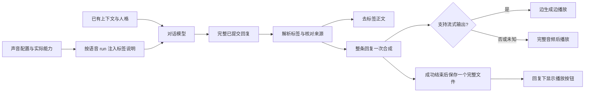
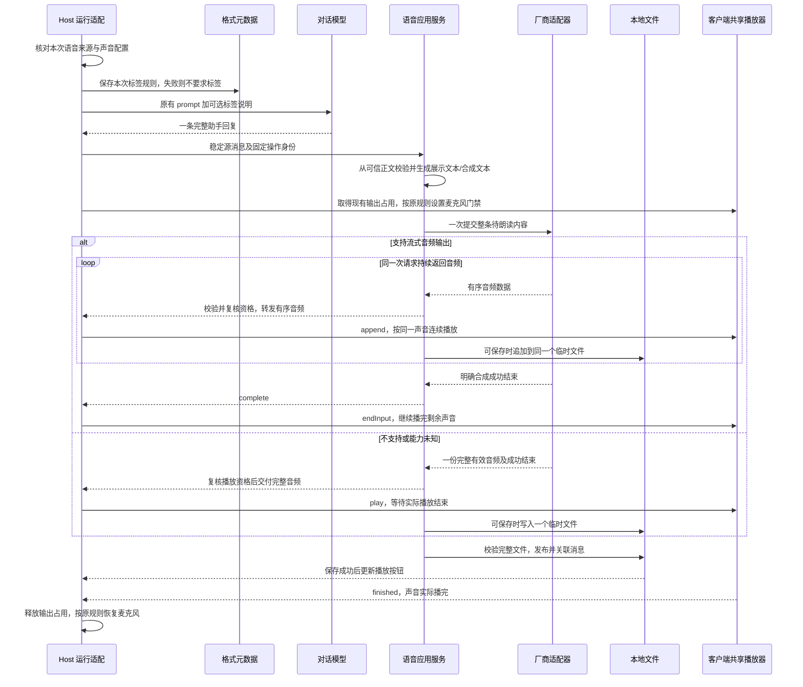
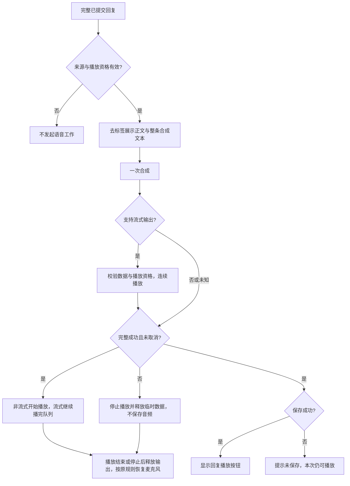

# 音色与情绪表达设计方案

**状态：IN REVIEW，尚未实施。** 日期：2026-11-17。

语音是独立模块，统一支持云端、本地和自托管的不同提供方。首期先接阿里云百炼，对话模型根据已有上下文直接生成所选厂商支持的情绪标签，语音模块负责说明、校验、合成、保存和播放。

**一条完整助手回复，一次合成，最终一个音频文件。整个方案不做分片，也不保留将来引入分片的路线。** 不设计逐句文件、播放列表、朗读清单或部分音频附件。提供方支持流式音频输出时，自动采用边生成边播放；不支持或能力未知时，等待完整音频后播放。只有成功结束的完整音频才能保存并显示回放按钮；失败或中止不发布文件。两种方式都先等待助手文字完整提交，再一次发送全文。

沿用宿主已有的消息身份、修订和取消事实，不新增音频/清单版本号、状态版本号或乐观锁协议。并发按固定操作 ID、正文摘要、当前有效性和明确取消状态处理。保存失败不能阻断本次正常语音播放。

## 1. 启用条件与核心决策

只有同时满足下列条件，才在 prompt 功能模块（项目术语为“能力说明”）中动态加入厂商情绪标签说明，并要求回答携带标签：

1. 已配置并选用了语音提供方及音色。
2. 当前模型、音色和接口支持对应情绪标签，适配器能够执行。
3. 当前 run 的有效触发输入为语音提交，且来源可由 Host 核对。

| 场景 | 行为 |
| --- | --- |
| 未配置语音厂商 | 保持现有默认语音方式，不增加情绪说明 |
| 已配置，但不支持情绪或能力未知 | 使用选定声音合成，不增加标签说明 |
| 支持情绪，但 run 来自文字、后台通知、主动消息或来源不明 | 不增加标签说明，按原有播报资格处理 |
| 已配置、支持情绪、run 来自语音提交 | 动态加入该厂商标签说明，对话模型直接生成标签 |

正在通话不等于当前 run 来自语音。通话中的文字输入仍可以按原有规则播报，但不因通话开启而要求标签。未配置时保留已有 Windows 默认路径；新的整条回复合成规则统一用于回复输出，不新增默认厂商或隐式云请求。

不增加独立情绪规划模型、不复制聊天上下文、不让语音模块重新生成回复内容。厂商默认情绪推断只作为无标签时的默认能力，不取代明确的标签控制。

## 2. 当前证据与实施落点

| 当前事实 | 源码及处理 |
| --- | --- |
| prompt 能力说明动态装配，但模块读取目前忽略请求上下文 | [persona](../core/modules/persona/README.md)、[modules.js](../core/modules/persona/modules.js)、[Host](../app/dsh/host/index.js)。将请求上下文传入语音说明贡献 |
| 现有电话策略以通话开启为条件 | [phone-policy.js](../app/dsh/adapters/tasks/phone-policy.js)。情绪说明使用更窄的语音 run 条件 |
| 现有 Client 提交只传正文与 requestId；来源元数据在目标实现中沿插件链路传递 | [conversation.js](../app/dsh/adapters/voice/conversation.js)。目标实现中，prompt 适配边界按既有 requestId 从内存关联取回来源，Host 按现有消费事件关联实际输入 |
| 回复正文可按 DSH 会话事件序号读取，`sessionId + seq` 是稳定引用 | [dsh-history.js](../app/dsh/adapters/event-engine/dsh-history.js)、[contracts.js](../core/modules/event-engine/domain/contracts.js)。归档身份复用现有事件引用，不与输入来源合并 |
| 当前按提交事件播放，输出仍逐句合成、用内存保存后释放 | [service.js](../core/modules/voice/service.js)、[音频存储](../app/shared/audio/clips.js)。改为等待每条消息完整提交后一次合成，移除该回复路径中的逐句循环 |
| 现有 Host 合成返回完整 base64 音频，没有持续转发播放通道 | [http.js](../app/dsh/adapters/voice/http.js)、[客户端适配](../app/dsh/client/voice/host.js)。为同一次请求增加连续音频传输与播放，不能只修改厂商流式参数 |
| 现有播放器只接受完整 clip，播放 Promise 在实际结束或停止时完成 | [playback.js](../app/shared/audio/playback.js)、[核心契约](../core/modules/voice/CONTRACT.md)。扩展第 8.3 节流式输入契约，保留实际播完才释放输出和麦克风门禁的规则 |
| Host 合成路由依赖通话租约，只接文字、音色与 rate | [http.js](../app/dsh/adapters/voice/http.js)、[客户端适配](../app/dsh/client/voice/host.js)。区分对话请求与独立试听入口 |
| 现有 replayReply 重新合成且依赖当前通话 | [核心契约](../core/modules/voice/CONTRACT.md)。文件回放使用单独入口 |
| 聊天视图缺少稳定音频附件引用 | [runtime.js](../app/dsh/ui/runtime.js)、[构建入口](../app/dsh/build.mjs)。消息投影补充源消息身份和可选 audio 摘要 |
| 配置与路由由 resources 管理，HTTP 无插件私有鉴权 | [resources](../app/shared/resources/index.js)、[README](../README.md)。沿用现有所有者及宿主访问边界 |

这些是当前实现事实，不代表目标功能已经支持。目标实现中，source 元数据从输入入口随提交在插件链路传递；只在 DSH prompt 适配边界按 requestId 取回，不做再次识别或网络/数据库查询。回复归档使用已有完整消息事件身份，surface replacement/revoke 后使旧关联失效。[历史调研](natural-voice-tts-research-2026-11-15.md)保留为背景，不作为当前实现状态。

## 3. 架构与所有者

### 3.1 业务架构



对话模型决定文字和情绪，语音模块拥有厂商语法与合成能力。标签只控制表达，不改变账号、模型、工具或播放权限。保存与本次播放分别处理，文件写入失败不丢失文字或阻断已生成音频播放。

### 3.2 系统交互



格式记录用于历史去标签，音频记录用于文件回放，两者归同一个仓库管理但清理规则不同。文件发布与实际播放结束分别推进，图中没有要求保存先于播放结束；保存失败不阻断播放。试听不创建对话消息，直接使用第 8.2 节独立请求；错误和取消的播放器收尾见第 8.3 节。

### 3.3 核心流程



流式播放前校验数据格式与预算，保存前再校验完整音频。流式中途失败时，已经播放的声音无法撤回，必须停止后续播放、丢弃临时文件并提示中断。中止后迟到数据不得重新播放或新增文件；保存已经成功的历史文件不会因为之后停止播放被删除。

| 所有者 | 职责 |
| --- | --- |
| 对话与运行适配 | 正文、实际输入来源、消息提交边界和已有取消事实 |
| persona 装配 | 按本请求条件加入或移除语音能力说明 |
| 独立语音模块 | 提供方能力、标签规则、整条合成、取消和输出仲裁 |
| Host 语音应用服务 | 凭证、可信正文读取、请求身份及落盘调度 |
| 回复视图 | 纯文本展示和有文件时的播放按钮 |
| 语音仓库与共享 audio | 格式元数据、一个文件的消息关联、磁盘清理、解码播放 |

## 4. 语音 run 与历史格式

### 4.1 发送入口记录来源

来源是插件提交元数据，随输入一路传递：语音由 ASR 产出 `{ text, source: 'voice' }`，文字入口产出 `{ text, source: 'text' }`；链路为 ASR/文字入口 → 语音服务 → 提交适配 → prompt 取用。ASR 只转写，不再次识别来源；source 不塞入 LLM 正文、不要求 DSH 新增字段，也不修改 DSH 宿主。

实现只需保留现有提交顺序：Client `beginSubmission()` 取得并保留既有 `submissionId/requestId`、pending echo 与回执；经插件现有 call lease 边界把该 ID 连同会话、`inputId` 与正文摘要登记到插件 Host；登记成功后用同一 ID 调用原 `session.prompt`。插件 Host 沿用现有 agent/inbox/claimed 消费事件，以 `message.source.rpcId` 和 `context.agent` 关联实际消费（工具步骤继承，新的前台文字消费以 `text` 覆盖）。

通用 `session.prompt` 只透传正文和 requestId；之后 DSH 独立消费输入并装配模型 prompt。因此仅在 prompt 适配边界按既有 requestId 从插件的内存关联取回 source。这里是本地关联读取，不是再次识别，也不是网络或数据库查询。

来源登记失败或被取消时，Client 适配器用本地持有的 submission handle 调用既有 `submission.abandon()`，清除对应 prepared 记录并结束本次准备，不继续 `session.prompt`；即使外层尚未拿到 submissionId，也由适配器本地收尾。该路径按现有 `not_applied` 准备失败/取消语义返回；Host 登记结果未知不把模型 prompt 标为 `unknown`，迟到登记回执也不得继续触发 prompt。此处复用现有取消语义，不新增状态机、ID、协议或兼容分支。

prompt assembly 早于当前 step/start/user-message 的持久写入，因此不能事后读取“最后一条消息”推断本次来源。登记但未消费的输入不影响其他 run；同一 turn 多次 steer 时，最新实际消费的前台输入为 voice 才启用、为 text 则关闭，独立后台通知或主动消息不继承。既有 requestId、会话或 inputId 关联不匹配/缺失时不注入标签；不从正文推断来源。

### 4.2 本次请求的固定上下文

prompt 适配边界从既有 requestId 内存关联取用本次实际消费的 source，再固定选定声音和允许标签；prompt 与返回解析使用同一份规则，不读取全局可变“当前厂商”。未命中条件时贡献空串，不添加空模块或额外要求。来源记录只描述输入入口；助手回复的归档身份另按 §11.1 的既有会话事件引用定位。

设置变更只影响后续请求，旧响应仍按其原规则解释。旧声音已不可用则保留文字，不拿新厂商解释旧标签。已发出的旧响应是否能播，继续由宿主已有取消和通话门禁决定。

### 4.3 持久格式记录

为避免历史回复在重启后露出标签，在语音仓库保存两类小记录：请求对应的标签规则，以及源消息对应的格式解释结果。它们只存来源、允许语法、正文摘要和控制标记的 UTF-16 区间，不复制聊天正文，不另建协议版本体系。

命中情绪条件时，先持久保存本次标签规则；保存成功后才向模型注入标签说明。保存失败则本次不注入标签，继续普通文字和整条语音合成。回复按 §11.1 的既有消息事件引用定位正文，并通过已有请求/turn-step 关联到回复 seq，映射本次格式记录；不新增模型 request ID 或宿主请求字段。若存储故障发生在模型请求派发后，当前进程继续使用已固定的内存规则去标签和合成。

历史显示、复制、转发和模型历史投影按原消息记录去标签，不依赖当前是否配置语音。摘要一致时可按已存控制区间直接清除标记；元数据暂不可用时尝试按原持久请求规则恢复，无法安全恢复的已知控制格式消息进入格式恢复状态，不用当前厂商猜测。

格式记录随消息保留，清音频、挂断、换厂商不删除；消息或会话删除时一起清理。SQLite 不可用不应成为当前可信回复实时合成的前置障碍，见第 8.1 节。

## 5. 提供方与标签契约

### 5.1 配置身份

providerId 表示具体协议适配器，connectionId 表示账户、地域或服务实例，modelId/voiceId 由该连接解释，deployment 为 cloud/local/self-hosted。不同账户或模型的同名音色不混用。本地也是多个提供方，不建立万能 local 分支。

角色档案保存声音绑定与表达偏好，引用已有的人格；音色创建仅在用户显式操作时调用，不混进一次回复合成。首期只选择已有可用系统音色。

### 5.2 提供方端口

以下为拟议职责，尚未实现。底层提供方不接收客户端自由指定的消息归属：

```ts
inspectConnection(connection, operation): Promise<ConnectionHealth>;
listVoices(connection, cursor, operation): Promise<VoicePage>;
resolveCapabilities(binding, operation): Promise<VoiceCapabilities>;
getEmotionPrompt(binding, capabilities): EmotionPromptSpec | null;
parseTaggedReply(rawText, promptSpec): ParsedSpeechReply;
synthesize({ binding, synthesisText, expression, requestId, format, audioOutput }, operation): AsyncIterable<SynthesisEvent>;
type SynthesisEvent =
  | { type: 'audio'; data: Uint8Array; format: AudioFormat }
  | { type: 'complete'; receipt: SynthesisReceipt };
cancel(requestId, reason): Promise<CancelReceipt>;
close(): Promise<void>;
```

能力按实际连接、模型、音色和接口声明；未知时不要求标签。ParsedSpeechReply 返回 plainText、整条 synthesisText、必要的整段表达与控制区间，不返回逐句音频任务。标签只能影响表达，不选择凭证、地址或消息归属。

`VoiceCapabilities.audioOutput` 标记为 `stream`（支持边生成边播放）、`complete`（仅完整返回）或 `unknown`（待确认）。能力按连接、模型、音色、接口和格式解析，不能仅凭厂商品牌或兼容协议继承。`stream` 自动采用流式输出，不增加用户开关；其他两种采用完整返回。切模型、地域或音色后重新解析，当前请求固定自己的结果；情绪能力与流式能力分别判断。

同一端口覆盖两种方式：流式连续产生有序 `audio` 事件，非流式在完整成功后产生一次 `audio` 事件，最后均须有 `complete`；错误或取消通过异常结束。音频事件只是一次请求内的连续数据，不是独立句子、文件或持久化任务。适配器映射厂商明确的成功结束标志，不将网络连接关闭当作成功；`complete` 只表示合成结束，播放器仍需播完剩余队列。它只触发播放器 `endInput()`，不能据此置播放为空闲、释放输出占用或恢复麦克风，见第 8.3 节。

### 5.3 一次请求中的情绪

优先使用厂商原生文本标签：plainText 去掉合法控制标记用于展示；synthesisText 保留经校验的厂商标签，一次提交整个回复。模型中的句间情绪变化由厂商在这一次合成内演绎，应用不拆句请求、不拼接多个音频文件。

仅支持整段情绪参数的提供方，只声明整段表达能力；不能冒充句内情绪切换，更不能通过拆请求补齐能力。缺标签使用默认表达，不支持的标签按能力规则丢弃或报错，绝不创建额外情绪模型调用。

## 6. 根据上下文直接生成情绪标签

模型使用原有上下文、角色设定和本轮沟通意图决定表达。用户伤心时优先温柔安慰；解释“伤心”一词时平稳说明；庆祝和紧急提醒使用对应的受支持表达，不把着急一律当愤怒。

阿里云 Qwen Audio TTS 官方列出了可直接写入 text 的标签，例如 `[sad]`、`[excited]`、`[empathetic]`、`[serious]`，并给出在同一文本第二句切换情绪的示例。首期优先使用此类模型和接口，实际调用前核对目标音色与非实时接口支持范围。[官方标签说明](https://help.aliyun.com/zh/model-studio/realtime-tts-user-guide)

```text
### 语音情绪表达

本次回答对应语音提交，将使用当前声音合成。
请根据上下文，在需要改变表达的位置加入本次支持的原生标签。
本次允许：[excited]、[sad]、[empathetic]、[serious]。
不要在工具调用、代码或引用原文内插入控制标签，不输出未列出的标签。
保持自然克制。主人难过时优先温柔安慰，不必跟着悲伤。
示例：[excited]太好了，你终于做完啦！[empathetic]先好好休息一下吧。
```

说明按实际能力动态生成，不包含密钥、账号标识或供应商整本手册。情绪强度与语速只开放已经验证的控制方式，不编造 `happy` 或 `calm` 为阿里云原生标签。笑、哭等拟声能力不默认启用。

## 7. 标签解析与朗读文本转换

仅处理完整已提交助手回复。展示正文 `plainText` 保留原有 Markdown 和内容，只移除本次确认有效的控制标签；朗读文本 `synthesisText` 单独转换，不能把转换结果写回聊天正文、复制内容或模型历史。未提交草稿及工具原始输出不合成，完整提交前不会为了提前出声另发请求。

先按原文位置区分真正的控制标签与代码、引用、行内代码中的字面文本，再转换朗读文本；不能先删反引号或引用标记，再凭剩余的 `[sad]` 判断情绪。只有本次规则允许、位于可控位置的实际标签可以原样进入厂商请求。

| 情况 | 处理 |
| --- | --- |
| 合法标签 | 从展示文字中移除，在厂商支持时保留于整条合成文本 |
| 缺标签 | 默认表达继续，不让模型重答 |
| 不支持或参数越界 | 丢弃该控制，正文继续；不转换为多次请求 |
| 畸形且无法安全分离 | 保留可恢复的展示文字，本条不合成，不误删正常正文 |
| 普通 run 或历史引用 | 不自行启用情绪；原已标注历史仍按持久记录显示 |

朗读文本只做确定性的格式转换，不增加模型调用，不改写、概括或截短普通正文：

| 原文内容 | 朗读处理 |
| --- | --- |
| 标题、列表、加粗等 Markdown 标记 | 去掉格式符号，保留文字、顺序及必要停顿 |
| Markdown 链接 | 保留链接名称，不读 URL；裸 URL 替换为“链接请看文字” |
| 围栏代码块 | 整块替换为“代码内容请看文字”，不逐字符朗读代码 |
| 行内代码及引用 | 保留可朗读文字；先处理下述标签字面量，再去掉格式标记 |
| 代码、引用、行内代码中，或本次未获准作为控制使用的厂商标签同形文本 | 不直接透传。例如字面量 `[sad]` 读为“方括号 sad”，避免厂商将它执行为情绪；此规则也覆盖未注入情绪说明的 run |
| 普通文字与标点 | 保留内容，不增加无关提示、不删减后半段 |

示例：在“标签 `[sad]` 表示悲伤”中，`[sad]` 若为行内代码，界面仍展示原样，朗读为“标签方括号 sad 表示悲伤”，不会触发悲伤表达；实际控制标签 `[sad]我有点难过。` 则从展示中去掉标签，合成时保留合法控制。

现有 [speech-text.js](../core/modules/voice/speech-text.js) 中超过 `maxChars` 后截断并追加“全文朗读”提示的行为不沿用。转换完成后按第 8 节检查整条请求预算；超限则不合成，不生成看似完整的前半段语音。若转换后没有可朗读内容，也不发起合成。

聊天流展示需要有界缓冲疑似标签前缀，避免半个标记闪现；文字完整提交后才发起一次 TTS，随后按音频输出能力播放。有效控制标签的移除规则覆盖复制、转发与模型历史输入，字面量保留。

## 8. 请求、取消与降级

每条完整回复只派发一次合成。`audioOutput=stream` 时，Host 在同一次请求内持续转发音频，播放器取得可解码数据后开始播放，后续音频按顺序连续接入；不等整条语音生成完成。`complete` 或 `unknown` 等待完整有效音频后播放。两种方式都沿用原有播放资格，首播、追加数据和文件发布前复核取消事实；不把所有 SSE 事件攒完再伪称流式播放。

**厂商流式返回与应用拆分回复是两回事。** 阿里云支持一次提交完整文本、通过 SSE 持续返回音频，属于单向流式。首期采用这条路径，无需流式提交文字或按句请求。[合成方式说明](https://help.aliyun.com/zh/model-studio/tts-model)、[HTTP 非实时合成及 SSE 示例](https://help.aliyun.com/zh/model-studio/non-realtime-tts-user-guide)。厂商网络数据边界不作为句子或文件边界，也不直接当成可独立解码的音频文件。

流式通路由现有 Host 语音路由与客户端适配承担：可信请求入口固定来源及 operationId，响应持续传输同一操作的音频和最终成功/错误信息；Host 消费厂商流后立即转发，客户端连续解码播放，不经过“完整 base64 回包再播放”的旧路径。客户端断开即取消该操作；重复同操作不再发起合成或从头重播。不新增独立流会话、清单或续传协议。

播放端优先选择适配器与播放器共同支持的流式格式；阿里云首期优先验证 PCM 输出，经参数校验后连续送入共享 audio 的采样播放队列，成功结束后补齐 WAV 文件头生成一个文件。其他编码须使用连续解码器，不能把任意网络数据逐份交给完整文件解码函数。播放用的解码数据不改变归档格式：按第 11.1 节保存原格式，只有裸 PCM 封装为 WAV。支持流式的接入必须同时完成厂商、Host 转发和播放器验证，不能因播放器未接好就默默改为完整等待。

播放队列限制缓冲时长与字节数，接收端对慢消费施加背压；厂商连接的有界缓冲仍无法容纳时取消并报告中断，不无限增长、不丢音频后继续冒充完整结果。设置请求总截止、首段音频等待与连续无数据截止，初值由真实账户验证后写入现有资源配置。浏览器音频未解锁或播放资格不可用时沿用现有门禁，不静音排队后补播。

新输入、挂断、回复撤销或当前操作取消后立即停止旧音频工作。合成中的操作尽力取消，迟到结果释放且不保存；合成已完成并发布的文件，之后单纯停止播放不删除它。取消本地等待不等于远端停止计算或退费。

| 错误 | 处理 |
| --- | --- |
| 认证、额度、音色无效 | 报告修复入口，文字继续，不自动换账户 |
| 请求未派发或明确未执行的临时失败 | 总截止内最多重试一次，仍为同一逻辑操作 |
| 派发后超时、断流或未知结果 | 立即停播并清空队列，不自动重发、不发布半份音频，记录可能计费；已有声音不能撤回 |
| 表达参数被明确拒绝且未执行 | 同音色默认表达最多降级一次 |
| 结果不完整、格式错误或超预算 | 停止当前播放、释放临时音频，无文件、无回放按钮 |
| 文件或索引写入失败 | 当前可信音频继续播放，包括流式接收与播放；提示未保存，不自动重合成 |

派发前文字超出单次上限或已知音频/解码预算时，文字保留并提示本条未生成语音；接收中才超出累计预算则停播，提示语音中断且不保存。不截取前半段冒充完整语音，不自动拆句绕过限制。现有逐句上限与整条回复上限不能直接混用，实施须在资源配置中明确单次可接受范围。长文范围之外的产品能力另行讨论，当前不建立拆分路线。

### 8.1 Host 对话合成入口

```ts
type StableSourceRef = {
  namespaceId: string; sessionId: string; seq: number; // DSH 既有会话事件引用
};
synthesizeReply({ operationId, callRef, source }: {
  operationId: string; callRef: ExistingCallRef; source: StableSourceRef;
}): AsyncIterable<SynthesisEvent>;
```

Host 通过现有 `sessionQuery.listEvents/readEvent` 按 namespace、sessionId、seq 读取完整助手消息正文；核对现有通话租约、取消事实和选定声音，生成整条合成文本及摘要。不信任客户端正文或“最后一条回复”。operationId 绑定该消息引用、文字摘要和声音；同操作同内容复用回执，同操作不同内容拒绝。供应商回执和保存结果关联到同一消息序号。输入来源标记与此回复归档身份分别维护。

**当前播放不依赖 SQLite。** Host 在内存保存已核对的正文、固定标签规则和本次合成参数，再尝试持久保存。数据库无法打开、只读、写失败或磁盘满时，仍从该内存记录完成本次合成和播放，关闭本次归档并提示未保存；不强制查库成功后派发。内存有条目/字节上限，随通话释放。

存储故障在模型派发前出现，则不注入标签，用普通完整正文合成；在带标签请求已发出后出现，则使用已固定的内存规则去标签和合成，后续可从先保存的请求记录恢复格式关联。可信来源或内存预算不可用时才停止该音频，不能退回客户端任意文字。Host 重启不重发未决合成。

### 8.2 独立试听入口

```ts
openPreview({ connectionId, binding, clientOwnerRef }): Promise<PreviewRef>;
synthesizePreview({ previewRef, operationId, text, expression, format }): AsyncIterable<SynthesisEvent>;
cancelPreview({ previewRef, operationId }): Promise<CancelReceipt>;
closePreview(previewRef): Promise<void>;
```

Host 按受信宿主连接核对所有者与可用绑定，clientOwnerRef 只是 UI 关联。试听不需要会话、通话租约或麦克风，不写回复附件。一次试听也是一次请求，固定文字、表达和声音后执行；自定义生成按相同能力自动流式播放或完整返回后播放，只有成功结束的完整结果可进入试听缓存。官方固定样音按普通媒体播放，不发合成请求。

试听空闲 60 秒回收，单次合成截止初始建议 10 秒，统一放入资源配置。关闭页面、切声音、断开连接或所有者失效时取消；活动请求受自身截止监督。取消按 previewRef/operationId 定位，不越域取消通话；实时合成已忙时试听返回 busy，不排无限队列。试听占用期间到来的实时请求按输出调度等待当前操作的有界收尾，不丢弃新回复；如实时输出期限已过，明确放弃旧音频，不事后补播。

### 8.3 共享播放器与实际播放结束

在现有共享 audio 播放器上增加流式输入，完整文件仍使用现有 `play()`。由同一个输出控制器取得占用后调用，不建立第二个播放器或另一套所有权：

```ts
playback.openStream({ format, operation, onStarted }): {
  append(data: Uint8Array): Promise<void>;
  endInput(): void;
  finished: Promise<{ ended?: boolean; stopped?: boolean }>;
  stop(): Promise<void>;
};
```

`format` 固定本次编码、容器、采样率、声道及适用的位深；中途变格式拒绝。`append()` 按顺序接受同一条音频的数据，处理跨网络边界的采样/编码余量，并提供第 8 节的有界背压；不能每次调用完整文件 `play()`，以免停止前面的声音。`onStarted` 只在本次开始实际发声时触发一次。

厂商明确成功且所有音频已追加后调用 `endInput()`，结束输入并处理解码余量，保留已经排入的声音继续播放；重复调用无副作用，此后拒绝追加。`finished` 只有在输入结束且最后的声音实际播放完毕时才返回 `ended:true`，不能以收到 `complete`、队列已移交给音频设备或网络结束代替。停止则返回 `stopped:true`，解码/播放失败则拒绝；所有终止路径都必须使等待结束。

`stop()` 幂等停止已经排入音频设备的声音、清空缓冲和解码余量，结束正在等待的 `append()` 并使尚未结束的 `finished` 返回停止结果；完成后旧数据不能重新发声。收到取消、断流或播放器失败时，语音服务同时停止本地播放并尽力取消仍在进行的合成，不等待远端确认才释放本地声音。合成截止在收到成功 `complete` 后解除，输入结束后的播放排空另按剩余音频时长设置截止，不能用合成截止截断尾音。音频设备挂起、断开或排空超时须报错并收尾，不能永久占用输出。

语音服务持有现有输出占用直到 `finished` 结束；完整文件的 `play()` 也遵循相同规则。扬声器轮流模式沿用现有麦克风门禁与尾部保护时间，实际播完或停止后才按当前通话条件恢复，输出专用模式不打开麦克风。合成完成或文件发布时不把播放状态改为空闲，不启动下一条回复或试听；这些入口均由同一输出控制器调度。手动回放需要抢占时，先停止旧播放并等待本地收尾，再取得输出占用，不允许声音重叠。

文件完整发布可以早于声音播完，不必等待 `finished` 才显示回放按钮；反过来，文件保存失败也不结束 `finished`。已经发布的文件不因后续单纯停止或播放设备故障而删除。

## 9. 阿里云配置与试听

### 9.1 云厂商预设卡片 UI

HTML 原型：[云厂商预设配置](prototypes/voice-presets.html)。卡片表示阿里云、MiniMax、豆包等厂商接入模板，不按角色声线分类。首期只有阿里云实际可配置启用；其他厂商在产品中若保留则标“后续接入”。现有 HTML 是多厂商设计演示，不代表实现状态。

配置表单选择宿主凭证引用、地域、模型与音色；“浏览音色与试听”弹窗内搜索、筛选和选用声音，保留手填音色 ID 入口。编辑声音不会立即切换当前服务，保存并启用才生效。未配置云厂商则沿用现有默认方式。原型没有真实音频或厂商调用。

卡片与配置详情分别标注“支持边生成边播放”“生成完成后播放”或“流式能力待确认”。内置卡片展示官方接口能力，详情以当前绑定解析结果为准；支持即自动采用，不提供开关。自定义端点即使选择兼容协议也先标待确认，不能继承原厂能力。原型中的能力说明与播放状态均为设计演示。

截至 2026-11-17，预设能力依据如下；官方支持与产品接入进度分别标注，后两家仍为后续接入：

| 云厂商与接口范围 | 卡片标记 | 采用方式与依据 |
| --- | --- | --- |
| 阿里云百炼 Qwen Audio TTS HTTP | 支持边生成边播放 | 首期采用完整文字一次提交、SSE 音频输出；`X-DashScope-SSE: enable`。[官方 API](https://help.aliyun.com/zh/model-studio/qwen-audio-tts-http-api) |
| MiniMax Speech 同步 HTTP | 支持边生成边播放 · 后续接入 | 接入后设置 `stream=true`，完整文字一次提交；具体模型及输出格式按官方约束选择。[官方 API](https://platform.minimax.io/docs/api-reference/speech-t2a-http) |
| 豆包语音 HTTP 单向流式 | 支持边生成边播放 · 后续接入 | 接入后采用单向流式接口，一次输入全文、持续输出音频；不要求双向文字输入。[官方 API](https://docs.volcengine.com/docs/doubao-voice/http-chunked-sse-unidirectional-streaming-v3?lang=en) |
| 自定义云端服务 | 流式能力待确认 | 由适配器按实际端点、模型、音色和格式声明，未知时完整返回后播放 |

### 9.2 官方样音与自定义试听

| 试听方式 | 行为与费用 |
| --- | --- |
| 官方样音 | 播放厂商固定录音，不调用合成，不随输入文字/情绪/语速改变；是否允许内嵌、免登录或缓存逐家核对 |
| 自定义生成 | 用户配置凭证、选择声音、填写最多 120 字及受支持的表达后显式生成；调用当前账户，按钮前持续提示按厂商规则计费 |

无官方样音就明确说明，不能自动转成收费合成。无凭证、无音色或空文字时禁用生成；公开样音与合成凭证分开。选用只回填表单，完成试听不会启用新配置。

阿里云官方有音色目录与试听入口，优先验证少量真实来源。[官方说明](https://help.aliyun.com/zh/model-studio/tts-model)。MiniMax 等后续厂商单独验证；不能假定所有音色枚举 API 都返回样音地址。[MiniMax 音色接口](https://platform.minimax.io/docs/api-reference/voice-management-get)

### 9.3 目录与缓存

目录按账户、地域、模型和音色隔离，提供名称、voiceId、语言、声音特征、真实表达能力和可选样音引用。切换模型/地域后重新确认兼容音色，不复用另一个模型的选择。静态官方目录记录来源与更新日期，不伪装成实时账户可用性。

样音引用记录官方来源、访问方式、格式、时长、过期和内嵌/缓存约束。Host 只解析固定可信来源，检查重定向、MIME 和大小；不能绕过登录、防盗链或使用任意 URL。只能外部访问时显示官方入口，链接失效最多刷新一次，失败后保留显式生成选项。

试听缓存复用同一仓库的临时文件能力，与回复音频分开。仅在允许时缓存官方样音；初始上限建议 24 小时、64 MiB，计入全局磁盘预算，不纳入资料导出。自定义结果按账户、模型、音色、文本摘要、情绪和语速缓存为一个完整文件；相同输入“再次播放”读缓存，改输入后再显式生成才发新请求。

试听不提交对话、不调用额外情绪模型、不创建音色资产、不打开麦克风。离开弹窗、切声音或停止后迟到结果不得重新播放。所有试听、历史回放与实时声音由同一个输出控制器互斥播放。

### 9.4 阿里云首期范围

先新增 aliyun-qwen-tts，使用用户百炼账户，优先北京地域和具备系统音色及原生情绪标签的 Qwen Audio TTS 路径。官方说明列出的 qwen-audio-3.1-tts-flash 等型号可作为接口验证起点；精确型号、账号、地域与非实时整段接口在接入验证时固定，不把 HTML 示意地址作为实际端点。

首期交付：阿里云卡片配置与检测、流式能力标记及自动选择、中文音色目录、可访问官方样音、显式生成试听、语音 run 的原生标签、完整回复一次合成并边生成边播放、本地一个文件保存和回复回放。单条正文的局部情绪变化通过第 6 节所列原生标签在同一次请求内实现，不按句拆请求；若所选接口不支持，就更正能力声明，不靠拼音频弥补。

顺序为：真实账户与单次流式合成/连续播放 → 音色目录/两种试听 → run 标签与去标签正文 → 本地保存/回复按钮。阿里云使用 SSE 音频增量，不依赖最终 URL 再下载一遍，也不把结束事件中的整段结果重复追加。Host 来源桥接与完整消息边界先验证；中间的试听可独立交付，但不代表完整对话闭环完成。CosyVoice、其他云厂商与新增本地模型后续扩展，不阻塞首期。

密钥由 Host 环境变量解析，配置保存 credentialRef，不进入 prompt、客户端或资料包。费用按连接计量，未知计费结果不提前释放为可用额度；诊断只存身份、原因和耗时，不默认记录完整文字或秘密。现有 HTTP 无插件私有鉴权，受信本机宿主为首期边界，远程共享服务需宿主身份与预算隔离。

## 10. 本地和自托管

不同模型服务各有适配器，复用同一次完整合成、一个文件、同一取消与存储规则。沿用相同的 `audioOutput` 能力标记，实际支持流式则自动边生成边播放；云端同名模型不代表本地情绪或流式能力一致。不支持标签时不贡献说明。外部服务只连接，应用托管的进程才负责暖机、回收与退出；模型下载或权重变更不是合成的隐式操作。

断网或资源不足明确报告，不暗中切云。参考素材通过 Host 资产引用解析，不接受模型生成的任意路径。后续提供方不引入音频拆分或部分文件能力。

## 11. 本地语音文件

### 11.1 文件与记录

云端和本地回复进入同一仓库，默认保存生成成功的助手语音；不保存用户麦克风、草稿、失败或未完成音频。目录由 resources 声明：

```text
voice/
  index.sqlite                 # 格式元数据和回复音频关联
  audio/<shard>/<audioId>.<ext> # 按实际保存格式确定后缀，一个完整文件
  tmp/<operationId>.part       # 尚未发布的单文件临时写入
  preview/                     # 短期试听文件
```

回复音频记录只需：audioId、稳定源消息引用、正文摘要、选定声音、相对文件引用、格式、时长、字节数、文件摘要、创建时间和可用状态。正文通过现有 `sessionQuery.listEvents/readEvent` 按 namespace、sessionId、seq 定位，契约明确 `sessionId + seq` 为稳定引用。surface replacement/revoke 后使旧关联失效。来源标记与回复身份分开存取，不用数组下标、时间戳或相似文字匹配，也不新增版本号。

保存策略为**已有容器保留原格式，裸 PCM 封装为 WAV**，不为统一后缀增加转码。Host 依据协商格式及完整文件校验结果，从支持的固定映射中选择后缀和 MIME：

| 返回音频 | 保存方式 | 文件后缀与 MIME |
| --- | --- | --- |
| 裸 PCM | 临时文件预留 WAV 文件头位置，顺序写 PCM；成功结束后按实际采样参数和长度补齐头部 | `.wav`、`audio/wav` |
| 完整 WAV 容器 | 保留原容器，校验文件头与实际长度一致 | `.wav`、`audio/wav` |
| MP3 | 顺序保存同一次请求的编码数据，完整校验后保留原格式 | `.mp3`、`audio/mpeg` |
| 其他已接入容器 | 只有适配器、完整文件校验及回放均支持时才纳入固定映射；例如 Ogg Opus 对应 `.ogg`、`audio/ogg` | 按实际容器确定，不把裸编码冒充容器文件 |

持久记录的格式描述保存后的文件，与后缀、MIME、实际编码及采样参数一致；PCM 封装后的记录为 WAV 容器及原 PCM 编码。后缀不能由客户端自由指定，也不能只改名把 MP3 当成 WAV。文件回放按记录的容器与编码解码，不能一律按 WAV 或固定采样率解释；试听缓存采用同一规则。

一条助手消息完整提交后再合成，不等整个业务任务或 turn 结束；同一个 turn 有多条助手消息时分别关联，不把它们拼成一条。宿主若无法提供某条消息的完整提交证明，该条暂不合成，不能把增量事件当完整回复。正文替换/撤销时旧关联失效，后续新生成内容只挂到其真实消息上。

### 11.2 保存和异常恢复

1. Host 从可信完整回复取得文字与表达，只发一次合成。流式音频一边播放一边顺序写入同一个临时文件；非流式完整返回后写入。保存资源预留失败时仍可接收和播放，不强制把整条流积存在内存。
2. 厂商明确成功结束后，按第 11.1 节完成容器信息并校验整份音频的格式、时长、大小；PCM 补齐 WAV 文件头，已有容器保留原格式。文件摘要针对最终文件字节计算；按实际格式确定后缀。临时文件与正式文件处于同一文件系统，原子 rename 到正式文件，再以索引事务关联源消息；发布前复核来源及取消事实。
3. 只有文件与关联都成功发布才显示播放入口。失败则清理未发布文件、提示未保存；不能因合成完成就声称已落盘，不自动重合成。
4. 同 operationId 同内容复用既有回执，内容冲突拒绝。同一源消息的重复事件不重复合成和写文件。操作登记在 Host 有界内存中，源消息撤销和取消通过当前状态核对，不引入版本计数。
5. 重启清理孤立临时文件、核对文件与索引；只有可验证的完整文件可恢复关联。未知合成不自动重发，丢失或损坏文件移除播放资格，不恢复半份音频。

存储故障不能中断可信的合成与播放路径，索引和文件失败按第 8.1 节处理。流式保存失败时关闭并清理临时文件，继续使用有界播放队列，不转为积存整条音频。合成时取消会停播并丢弃结果；文件已完整发布后，仅停止播放不删除历史文件。清理音频不删除历史去标签所需格式记录。

### 11.3 保留和读取

初始默认保留 30 天、总配额 512 MiB，先到触发清理；预览文件、临时文件和预留都计入预算，另设文件数上限。先删过期，再从旧到新删；没有空间则停止新保存，实时播放继续。挂断、切页、重启或换当前聊天不删除已存文件；源消息/会话被删除时撤销关联并清理。

文件读取只在实际打开文件期间短时保护该文件：Host 按现有连接核对所有者和源消息，登记在读句柄，读取结束、失败、客户端断开或最长 30 秒读取截止时关闭并解除保护。完成加载后的内存播放不持有磁盘锁，无需公开读取租约、续租或新版本协议；Host 重启也不恢复旧读取占用。删除与打开文件的短操作串行执行，不持锁等待网络，失联连接不会让文件永久跳过清理。

仓库仅提供必要职责：保存请求/回复格式、发布完整音频、按可见消息批量查音频、读取单文件、使源关联失效、清理文件。消息列表返回不透明 audioId 与时长，文件接口不接任意路径。UI 不持久化音频字节或磁盘路径，`.fishpack` 首期不包含音频和试听缓存。

## 12. 聊天回复播放

只有助手回复存在完整、已发布且仍匹配正文的文件时，气泡下显示“▶ 播放语音 · 时长”。生成中、失败、取消、无文件、文件损坏/被清理、用户消息和欢迎占位均不显示按钮或空行。不显示“播放已生成部分”，不创建部分语音状态。

通话自动播报可在合成中连续播放，这不依赖聊天回放按钮。文件成功发布后才显示永久回放入口；当前自动播放不会因为文件就绪又从头播放一次，实时生成和播放状态沿用当前通话区域。

点击触发 `playStoredReply(audioId)`，读取该完整文件并播放；不合成、不调用对话、不打开麦克风或通话。当前没有凭证、换了厂商、云端断网，也不影响已有本地文件回放。播放中按钮变“■ 停止播放”，自然结束恢复；首期不做拖动和历史自动连播。

用户点击时解锁 AudioContext，再读取音频，服从单文件解码预算。一次只允许一个声音，切回复停止上一个；快速停止后迟到读取不得重新发声。文件已失效时移除按钮并轻提示，文字保留。当前可见消息批量查附件，文件就绪后局部更新，不为每条消息各发请求。

通话中手动回放停止当前自动播报，并在回放期间挂起新自动播放；不积压旧回复等结束后补播。用户讲话、新输入、挂断、重置、切页/切会话停止手动播放；这些停止不取消外部业务任务。现有应用级通话跨页生命周期不因消息视图卸载改变。

[聊天源文件](../app/dsh/ui/runtime.js)与消息桥接增加稳定 source 引用及可选 audio 摘要，按钮调共享输出控制器；client.js 由正常构建生成。按钮提供键盘、可见焦点和含回复定位的可访问名称。

## 13. 兼容与交付

1. 在插件语音发送入口登记来源，并用既有提交 ID 通过 Host 现有消费事件关联；回复归档用既有 `sessionId + seq` 引用读取完整助手消息。
2. 增加阿里云配置、能力标记、一次全文请求的流式音频转发与连续播放、独立试听和固定规则元数据；保留未配置/无情绪时的原有选择与 prompt 行为。
3. 原生标签的合成文本与展示正文分离，消息一次提交完成后只发一次 TTS；移除现有对话输出中的逐句合成循环，不引入新的拆分路径。
4. 加入单文件保存、恢复、超时读取及聊天回放按钮。旧 Host 不支持时不显示文件按钮，未知配置继续按现有资源策略保留。
5. 阿里云闭环验收后扩展其他提供方，始终保持“一条回复、一次合成、一个文件”，不列音频拆分或逐句预合成的后续计划。支持流式音频的提供方自动边生成边播放，不支持或能力未知的完整返回后播放。

## 14. 验证契约

| 场景 | 必须满足 |
| --- | --- |
| 未配置、不支持情绪、文字 run、后台通知 | 按启用矩阵处理，通话开启不能代替语音来源 |
| 语音 run 与原生标签 | 说明按真实能力注入，标签不出现在展示、复制或模型历史中 |
| Markdown、链接、代码及引用中的标签字面量 | 展示内容保留；按第 7 节转换朗读，不将字面量交给厂商执行为情绪；未注入标签的 run 同样验证 |
| 超长文字或转换后无可朗读内容 | 不调用旧截断逻辑，不合成前半段；超限提示原因，空内容不派发 |
| 含多句话与不同情绪的一条完整回复 | 仅一次逻辑合成、一个完整结果；局部情绪由同一请求的原生能力演绎 |
| 流式支持、不支持、未知及更换模型/端点 | 标记来自实际绑定，支持自动流式，其余完整等待；自定义端点不继承原厂能力，无需用户开关 |
| 人为延迟尾部音频的流式请求 | 在厂商结束前已播放首段声音；仅一次合成、一个临时文件，结束后发布一个完整文件，不重头播或重复追加最终结果 |
| 流式断流、取消、客户端断开及缓冲超限 | 停播并清空队列，取消远端、迟到丢弃，无残缺文件/按钮、不重发；提示已播部分无法撤回 |
| 流式保存失败、慢消费及不完整编码数据边界 | 保存失败继续有界播放；背压或超限终止，无无限内存或数据丢弃；跨网络边界正确连续解码 |
| 合成已 complete 但声音未播完 | 仅结束播放器输入；尾音继续、输出保持占用、麦克风门禁保持，下一条回复或试听不得提前抢入 |
| 流式播放自然结束、停止、失败及音频设备挂起 | finished 在实际播完/停止/失败时结束；排空超时收尾，停止清除设备中已排入声音；按原规则恢复麦克风，不接受迟到追加 |
| PCM、WAV、MP3 及已接入的其他容器保存/回放 | 仍为一个文件；后缀、MIME、持久格式与文件字节一致，PCM 按实际长度封装 WAV，回放按真实格式和采样参数解码 |
| 多条助手消息同属一个 turn | 按稳定消息各自处理，不混挂、不等待整个任务结束 |
| 消息增量、生成中、超预算长回复 | 不提前合成，不发布不完整音频；超限明确报告，不自动拆请求 |
| 合成失败、中止、未知结果、取消后迟到 | 无新文件和按钮，不盲重发、不重新发声 |
| 来源登记失败或登记期间取消，含迟到登记回执 | Client 适配器用本地 submission handle 调用 `submission.abandon()` 并清除 prepared 记录；按 `not_applied` 返回，不调用 `session.prompt`、不将模型投递标为 `unknown`，迟到回执不触发 prompt |
| 文件已发布后停止播放 | 历史文件保留，之后可回放 |
| 满盘、只读或 SQLite 不可用 | 从可信内存完整回复继续合成/播放，只停归档，文字保留 |
| 同 operationId 重用不同文字、跨会话或撤销来源 | 派发前拒绝；不信任 Client 正文、不按最后一条回复挂文件 |
| 提交来源不匹配、跨会话或未消费；回复消息被 replacement/revoke | 不启用来源标签或不派发；不信任 Client 正文、不按最后一条消息挂文件，旧归档关联失效 |
| 重启、换厂商、清理音频后的历史消息 | 格式仍能安全显示，文件可用时回放不请求云端 |
| 文件写入/rename/索引之间崩溃 | 不公开临时或孤立结果，恢复不重发未知合成 |
| 读文件中断、客户端崩溃、Host 重启 | 句柄按结束/失联/截止释放，无永久占用阻塞清理 |
| 无音频、文件删除或损坏 | 无播放按钮；已点按钮读失败时移除并提示 |
| 试听搜索、选择、切情绪或无凭证 | 不自动生成，生成按必需字段禁用；缺样音不转收费 |
| 显式生成及缓存回放 | 费用说明持续可见，同输入再次播放不新增请求 |
| 本地离线、暖机或资源不足 | 按实际能力报告，不暗中切云，不加入拆分补偿逻辑 |

沿用相关 test:voice、persona、配置测试，增加单次请求计数、完整消息身份、原生标签、存储降级、取消竞态、完整文件发布及断连读取回收验证。试听听感记录自然度、角色一致性、情绪辨认、文字提交到首声的等待及播放连续性，不能用厂商首包宣传代替实际体验。本轮只修设计，不宣称运行、真实厂商或声音验收通过。

## 15. 复审与待验证项

本版修复 Host 消息归属、历史格式保存、独立试听、存储故障降级和文件读取回收。按用户明确要求，移除逐句音频、朗读清单、封口/结算、部分音频及新增版本系统。保存是否成功只以一个完整文件及其关联为准。

### Open Decisions

无待用户决定的产品方向。来源元数据随插件提交传递，在 prompt 适配边界通过既有 requestId 的内存关联取用；Host 的 agent/inbox/claimed 事件负责关联实际消费。回复归档独立复用 `sessionQuery.listEvents/readEvent` 与 `sessionId + seq` 稳定引用。不得新增 DSH 宿主字段或模型 request ID。阿里云整条文本原生标签路径有官方依据，具体非实时接口、模型和音色仍需账户验证。

### Revision History

| 日期 | 变更 |
| --- | --- |
| 2026-11-17 | 确认对话模型直接生成厂商情绪标签、云/本地统一边界，先接阿里云 |
| 2026-11-17 | 增加厂商卡片 HTML、两种试听、本地文件与回复回放 |
| 2026-11-17 | 根据 review 补充消息归属、格式持久化、独立试听、存储降级与读取回收 |
| 2026-11-17 | 按用户要求统一为整条回复一次合成、一个文件；移除拆分、部分文件、清单状态机及额外版本设计 |
| 2026-11-17 | 明确最小朗读转换、标签字面量隔离及移除旧截断行为；区分单次请求流式返回与拆分回复 |
| 2026-11-17 | 按用户确认增加厂商流式能力标记，支持即自动边生成边播放；同步转发、取消、单文件保存、试听及 HTML 标记 |
| 2026-11-17 | 修复 review 两项：补充流式播放器输入、实际播放结束及输出/麦克风释放契约；按真实格式保存文件，PCM 封装 WAV |
| 2026-11-17 | 简化语音入口来源登记与实际消费关联；回复归档改用既有 sessionId + seq 身份，来源与消息身份分开 |

### Readiness Score

不再用自评分代替开发准备证据。当前仍为 IN REVIEW：边界与异常路径已定义，插件实施按既有提交与事件边界推进，再按第 14 节取得真实运行证据。
