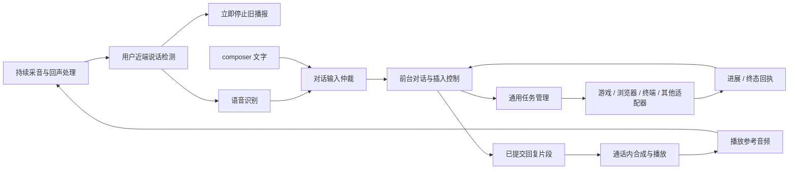

# 大肥鱼通话设计 v4：随时对话、长任务并行与插话

日期：2026-11-15。以用户本轮三项澄清为准，替代 v3 中扬声器轮流说话和等待整轮结束的限制；撤回“未开通话也自动朗读”。锄地只是长任务示例，本方案适用于游戏、浏览器、终端、文件处理和其他外部任务。

状态：产品与技术方案已按独立审查修订并完成复审，记录见[自审记录](voice-call-v4-self-review.md)。仅“关闭通话不自动播报”的纠正已进入代码；下文的插入投递、通用后台任务和扬声器插话仍待实施与实机验收，不沿用旧版测试宣称完成。

## 1. 用户感受到的行为

| 场景 | 目标行为 |
| --- | --- |
| 通话关闭 | 正常文字聊天，不开麦、不自动播报；发送文字不能偷偷开启输出连接 |
| 点击唯一语音按钮 | 开始电话式持续沟通，图标切换；不需要每句话手动停止或发送 |
| 通话开启、用户说话或打字 | 新输入进入当前对话，不等上一个长任务完成；新回复自动播报 |
| 大肥鱼正在执行长任务，用户闲聊 | 正常回答；任务按自己的生命周期继续，聊天不占用任务的操作锁 |
| 用户说“停下／改做另一个” | 理解并定位具体任务，发出任务取消或变更；按真实执行回执反馈，不以“停止模型生成”冒充任务停止 |
| 大肥鱼正在说话，用户开口 | 检测到用户近端说话便停止当前播报并继续听，不等完整识别结果或当前语音播完 |
| 用户再次点击语音按钮 | 结束本次通话、停止采音和播报；后台业务任务不因挂断被默认为取消 |

保留 composer 发送按钮旁的一个按钮。任务接收、进展、停止和完成使用已有聊天消息表达，不新增悬浮通话条或语音控制面板。

## 2. 当前实现为什么不符合目标

已基于本仓库和当前安装 DSH `0.2.2-rc.1` 的本地代码核对：

1. `app/dsh/build.mjs` 的文字发送，以及 `app/dsh/adapters/voice/conversation.js` 的语音准备和发送均固定为 `queue`。
2. `core/modules/voice/service.js` 另外要求之前 accepted 的输入已经 `turnEnded`，才投递下一句。仅把 DSH 参数换成插入模式，语音仍会在核心排队。
3. DSH 的 `steer` 投到 `next-step`，`queue` 投到 `next-turn`。`steer` 不调用取消；当前 step 在等待工具批次时，新消息仍需等待该 step 结束。
4. 业务工具可能已异步：例如本机游戏工具提交任务立即返回 requestId，但它的等待工具默认等 10 秒、最多 20 秒。反复在前台等待，仍会阻塞对话。这是通用的“把等待留在对话执行链”问题，不是为游戏写一个特殊判断能解决。
5. 默认扬声器模式播报时 gate 采集，`capture.js` 在 gated 状态下不将 PCM 送入 VAD；因此核心虽有中断播放逻辑，却收不到用户的 speech-start。
6. 会话适配器仅到 `turn/end` 才合并生成 `reply.final`，核心又以整个 turn 的活动状态阻止播放。因此“先说一句我去做，随后继续工作”也不能及时播报。

以上是代码事实；没有据此声称已经复现或修好了任意外部任务的所有阻塞路径。

## 3. 采用的整体方案

将三个生命周期分开：通话保持连接、前台对话响应、后台任务执行。它们关联身份，但不互相作为完成条件。

只改 `queue` 无法消除长工具和 turn 级播报的等待；每来一句就无条件取消整个 Agent 也可能打断写入、丢失工具结果或误取消已有任务。采用前台短响应、后台任务句柄和有条件的前台抢占。

## 4. 新消息如何插入

- 当前大肥鱼的主人对话，文字与最终语音使用统一投递策略。DSH 映射为 `steer`；空闲时照常开始对话，运行中进入下一步输入。
- 核心只对“提交接收过程”做有界串行，不等待先前业务 turn 或任务结束。prepare 与 prompt 必须使用同一模式、同一稳定提交身份。
- 识别最终文本入会话前，停止旧播报，更新对话输入版本；旧回复不能覆盖新意图。
- 结果未知的输入保留身份核对且不自动重发，但不以一个未知输入永久封锁之后的闲聊。新输入使用新身份；任务变更另有 taskId、版本和操作回执，禁止过期任务指令在停止后重新生效。
- 如果前台还在模型生成，DSH 适配器可以在接收新输入后有条件地取消旧前台生成，并保留已接收输入。取消必须核对预期前台版本；新响应已开始时不能误杀它。取消还必须保证已接收输入继续被调度，无需用户再说一句来唤醒；不通过重发正文补救。当前 DSH 必须先验证插件 Host 的条件取消及可靠唤醒能力，缺失时明确报告抢占不可用。
- 不对正在执行且结果不明的不可逆工具直接强制取消。长工具通过后台任务解耦；短的不可中断提交只跨越自身的安全边界，不等待整个业务任务完成。

“插入”保证接收与调度优先级，不承诺远端模型在固定毫秒内回答；模型生成延迟与本地停播延迟分别记录。

## 5. 通用长任务执行

前台负责听、说、解释、规划和控制，后台任务负责执行与观察。原生已异步的工具复用其 requestId；仅阻塞的工具由可管理的后台执行器承接，不把同一外部任务再启动一遍。

任务至少记录 taskId、稳定所属对话、触发输入、资源范围、任务版本、外部操作身份、状态及最后真实回执。所属对话不包含进程、通话或临时绑定版本；任务 ID 与通话 ID 独立，挂断、绑定重建或 Host 重启后仍有管理入口。会话被删除或权限失效时如实反馈，不自动迁入新会话。

- 开始后尽快返回任务句柄与接收事实，前台不循环调用 10–20 秒等待工具，也不靠提示词约束来保证不阻塞。
- 任何外部执行前先持久化稳定 operationId 与任务账本；超时先按原身份查询，不换身份重启。外部接口不支持幂等或查询时保留结果未知，不能假设未执行。
- 外部适配器提供状态查询、进展订阅或受控轮询、取消及恢复能力。只有阻塞接口时由后台运行，前台不持有其等待承诺。
- 同一资源上的冲突操作跨会话串行。例如同一个角色、浏览器页面、文件写入目标；普通聊天无需这些锁。停止未确认或结果未知时保留资源隔离，不能因本地租约过期就启动冲突操作。
- 闲聊不取消工作。“停下”取消具体任务；“换个目标”更新版本并在旧操作安全结算后交接资源。不能把所有新输入视为取消命令。
- 重复完成通知按任务事件身份去重。停止、失败和部分完成都据实说明；无法证明停止时保持 stopping 或 outcome-unknown。
- 会话重置不会把旧任务自动接到新会话。旧任务保留所属会话和管理入口；应用退出按适配器能力停止、持久化或恢复，不承诺所有外部副作用都可撤回。

## 6. 说话时打断大肥鱼

通话期间即使 TTS 正在播放，采集与检测也持续运行。用户开始说话时，本地中断只处理音频输出，不等待 ASR、DSH 或任务响应：

1. 确认近端说话，立即停止当前音源，取消未完成合成，丢弃尚未播放的旧片段。
2. 保留约 300 ms 预录，继续收集用户本句，避免吞掉第一个字；用户讲话和等待本句识别期间都不启动新的普通播报或任务通知。
3. 识别结束后把新输入插入前台对话；旧片段及被打断响应之后新增的片段均不能重新播放。多次起音分别有身份，旧识别回调不能解除新一句的播放门禁。
4. 开口后没有有效识别文本或识别失败/超时时，结算本次输入尝试并保持通话，不擅自续播旧句，也不取消业务任务；需要重说时在原聊天中提示。说完后整句自动识别收尾最多等待 30 秒，失败不晚发，下一句可继续输入。

确定未提交的识别失败音频在提示后释放，不增加需要用户手动清理的面板。设备故障或预算确实耗尽时结束本次通话，按钮恢复关闭并在原聊天说明原因，不能保留“按钮开着但已停止收音”的假连接；在途提交仍按原身份核对，业务任务继续。

扬声器场景必须区分用户声音与大肥鱼自己的回声。先验证当前浏览器实际取得的 echoCancellation 设置及 HECATE 实机表现；仅设置 `echoCancellation:true` 不作为验收证明。若浏览器链路不足，使用共享音频端口的渲染参考 + 回声处理实现，而不是静默退回“说话时不听”。

耳机与 HECATE 扬声器分别验收；仅耳机通过不等于本需求完成。浏览器能力不足时如实提示，不能把失败路径记为全双工可用。

## 7. 回复何时播报

把“本段回复可播”与“整轮任务结束”分开。读取已提交的 assistant/message 文本片段，在合法来源、当前会话与输入版本匹配时播放；不等待整个 turn/end。

未提交的流式草稿、思考、工具参数和工具原始输出不播报。片段须有稳定身份和修订版本，重复事件不重播；已被新输入打断的旧片段不恢复。任务进展只能播报已产生的真实事实，不能用固定“我已经做完”代替结果。

## 8. 验收与实施顺序

| 顺序 | 验收内容 | 必须保留的证据 |
| --- | --- | --- |
| 1 | 关闭通话后发送文字只显示文字；开启后回复播报 | 按钮状态、无额外音源、通话内播放回执 |
| 2 | 有前台 turn 运行时连续接收多句，prepare/prompt 均为 steer | 每句稳定身份、接收/消费事件、无 turnEnded 等待 |
| 3 | 模拟 60 秒通用任务，期间多次闲聊和任务控制 | 闲聊回复、任务持续进展、停止/变更回执和资源版本 |
| 4 | 一句回复已提交、后续任务尚未结束时开始播报 | 片段提交、播放开始、任务终态三者的时间顺序 |
| 5 | TTS 播放中用户插话，每条设备路径至少 100 次尝试 | 用户近端起点、停播时间、识别文本、未复播/未吞首字，含漏检记录 |
| 6 | 扬声器仅回放、用户与回放重叠、系统其他声音 | 回声误触发、误提交、正确识别与播放参考对齐 |
| 7 | 迟到合成、重置、未知接收、取消与任务完成竞态 | 不串会话、不重复副作用、不丢任务控制权 |
| 8 | 接收后取消旧生成，之后不再发消息 | 新输入仍被消费；无重发正文、无重复 driver |
| 9 | 启动回执丢失、进程重启、绑定变化、未知任务占资源 | 原 operationId 可查询、稳定 owner 可管理、冲突操作不越过未知任务 |
| 10 | 讲话中新增回复、ASR 无 final/失败/乱序、连续起音 | 待决期持续停播、有限期限收尾、下一句可继续、旧回调不解锁新一句 |

本地停播目标：从参考录音中用户真实近端起音到实际输出停止，端到端 P95 不高于 300 ms，包含近端检测耗时，不包含语音结束等待和远端模型推理；另列检测延迟与确认后停止延迟。每种设备/输出路径至少 100 次真实插话尝试（含未检出的样本），低音量、短词、重叠和背景声分组统计，不能用排除漏检的样本达到目标。仅大肥鱼回放且无人说话的 10 分钟测试中，误提交为 0；该场景误停播也须为 0。实际难例和全部失败保留统计，不以单段干净样本代替设备验收。

技术端口、DSH 插入与条件取消映射、任务版本及回复片段模型见[技术方案 v3](voice-call-technical-v3.md)。
