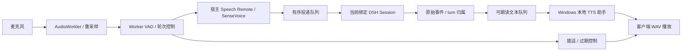

# 大肥鱼 · Windows 连续语音通话技术方案 v1

> 2026-11-14 修订：当前实施依据为[技术方案 v2：DSH 插件实施与桌面端扩展](voice-call-technical-v2.md)，评审见[v2 review](voice-call-technical-review-v2.md)。本页保留初稿；其中核心端口、目录、租约保证范围、音频保留和 Host API 认证说明均以 v2 为准。

- 日期：2026-11-14；项目基线 `3b5cd09` / `0.4.10`。
- 状态：待实现。本文中的模块、端口、参数和测试均为设计，不代表现有功能。
- 产品依据：[通话设计 v2](windows-voice-call-design-v2.md)；[自审记录](windows-voice-call-review-v1.md)。
- 上游核对：DeepSeek Harness `39163dd30f703a79079e2d2446545cff3c453738`，不假定用户已安装版本与上游 master 相同。

## 1. 已确认的接入面

| 位置 | 现状 | 本次改造 |
| --- | --- | --- |
| [runtime.js](../app/dsh/ui/runtime.js) `send` / `sendReal` | 表单忙时返回，清空输入框；真实发送失败后调用 `sendDemo` | 语音绕开表单和演示降级；复用抽出的真实投递端口 |
| [build.mjs](../app/dsh/build.mjs) `createFishChat` | 使用 `binding.session.prompt([{type:'text',text}], 'queue')`，只判断 `result.ok`；send 未返回身份回执 | 暴露绑定 Session 身份与结构化接收结果，不把 resolve 当作回复结束 |
| 同上 `getMessages` | 渲染 `user/message` 与 `assistant/message`，丢弃 event seq、turn、source 等信息 | 新增原始事件投影，不用消息长度或最后一条文本检测播报 |
| [dsh-source.js](../app/dsh/adapters/event-engine/dsh-source.js) | 已处理 `turn/start`、`assistant/message`、`turn/end`，保留 seq 和来源 | 复用事件语义，不把语音接到语义抽取任务上 |
| [资源规格](../core/contracts/spec.js) | 集中管理路径、路由、默认配置与构建投影 | 新增 voice 资源规格，禁止散落硬编码 |

宿主识别：`ctx.remote.speech` 是可选的实验性 Remote，不属于稳定 Remote 的默认保证。需要核对当前版本中由谁挂载生成的 contribution，并在本插件注入前观察其存在；若不由已有语音 Bundle 挂载，适配层应按该版本生成机制自行挂载并持有 disposer，避免重复挂载。不能仅在 UI 中调用一个假定存在的属性。

上游核对依据：[语音子系统](https://github.com/deepseek-ai/deepseek-harness/blob/39163dd30f703a79079e2d2446545cff3c453738/docs/subsystems/voice-input.zh.md)、[Remote 挂载](https://github.com/deepseek-ai/deepseek-harness/blob/39163dd30f703a79079e2d2446545cff3c453738/packages/experimental/client-ui-voice-input/src/client/mount.ts)、[请求类型](https://github.com/deepseek-ai/deepseek-harness/blob/39163dd30f703a79079e2d2446545cff3c453738/packages/experimental/api-speech-to-text/src/types.ts)、[WAV 校验](https://github.com/deepseek-ai/deepseek-harness/blob/39163dd30f703a79079e2d2446545cff3c453738/packages/experimental/speech-to-text/src/wave.ts)。这组接口支持完整录音转写，既不自动投递，也不提供 TTS。

进一步核对了上游 [Session 客户端契约](https://github.com/deepseek-ai/deepseek-harness/blob/39163dd30f703a79079e2d2446545cff3c453738/packages/api/session-controller/src/client/contract/session.ts)与[实现](https://github.com/deepseek-ai/deepseek-harness/blob/39163dd30f703a79079e2d2446545cff3c453738/packages/api/session-controller/src/client/sessions/session.ts)：该版本支持 `beginSubmission()` 产生 requestId，作为 `prompt(content, 'queue', signal, requestId)` 第四个参数；用户事件和 inbox 的 `source.rpcId` 可关联提交。RPC 成功值只有 `{accepted:true}`，不能把它误写成 messageId 回执。requestId 是身份线索，其存在不等于已经证明服务端重试幂等。

## 2. 技术选择与模块边界

输入采用插件面板持续采音、浏览器端 Silero VAD 判定轮次、宿主 SenseVoice 本机转写。VAD 在 Worker 中通过 ONNX Runtime Web WASM 运行；模型、WASM、Worker 和 AudioWorklet 随插件交付到同源资源，不依赖运行时 CDN，也不读取宿主私有缓存路径。VAD 具体版本、哈希和许可证在实施时锁定，同源资源与 CSP 验证列为第一个实施阶段的门槛。[Silero 官方实现](https://github.com/snakers4/silero-vad)

输出采用 Windows 本地 `System.Speech` 合成 WAV，返回当前客户端，由同一个 AudioContext 播放。首版不依赖浏览器 `speechSynthesis`：需要可控的 PCM 播放、可立即停止的独立播放队列与实际播放时间。Windows 合成助手不直接向系统扬声器发声。

Windows 助手拟通过系统 Windows PowerShell 5.1 加载 .NET Framework `System.Speech`，常驻一个隐藏子进程，通过 UTF-8 JSON 行收发命令和限长 base64 WAV。使用固定入口与参数数组、`shell:false`、`windowsHide:true`；用户文本只进入 stdin 数据，使用普通文本合成而非 SSML。系统缺组件、策略阻止或没有可用中文音色时返回明确 capability 失败，不改系统策略或注册表。语音能力只在用户准备或开启通话时探测，不在插件 import 时启动进程。

本地合成能力来自 Microsoft 的[可用音色枚举](https://learn.microsoft.com/en-us/dotnet/api/system.speech.synthesis.speechsynthesizer.getinstalledvoices?view=netframework-4.8.1)和[输出 WAV 流](https://learn.microsoft.com/en-us/dotnet/api/system.speech.synthesis.speechsynthesizer.setoutputtowavestream?view=netframework-4.8.1)。声音由实际 Enabled 音色决定，不硬编码某个名字，也不把 Windows 设置中显示的全部音色都当作 System.Speech 可见。



拟新增布局：

```text
core/modules/voice/
  call.js, turns.js, delivery.js, replies.js, limits.js, tests/
app/dsh/ui/voice/
  controller.js, audio.js, capture.worklet.js, vad.worker.js, bar.js, tests/
app/dsh/adapters/voice/
  speech.js, session.js, index.js, http.js, tests/
app/shared/platform/voice/
  windows-tts.js, windows-tts.ps1
```

核心以纯事件和注入端口运行，不直接 import DOM、DSH 或 Windows API。平台能力从 `app/shared/platform/index.js` 选路并注入；新 TTS 文件不使业务模块自行判断 `process.platform`。控制器由插件级 apply 生命周期持有，聊天页与其他页面只挂载视图；不能绑定到会被路由卸载的 runtime 实例。`build.mjs` 负责生成 client.js 和音频附属资源，不手改生成文件。

通话条复用现有 `shell.overlay` 挂载能力，确保所有插件页面及离开聊天页后都有可见的结束入口。一个客户端只有一个控制器；Host 另以 Session 为键持有短租约，防止其他 DSH 窗口再次开启同一通话。拟新增 acquire/renew/release 端口，租期 15 秒、5 秒续租；第二窗口显示「此会话正在另一窗口通话」。失去续租或过期先停采音与新提交，再释放资源，旧在途提交只核对。服务重启租约丢失，客户端进入 paused，不自动重新抢占。租约令牌只作为业务归属与 fencing 代号，不宣称是鉴权机制。

## 3. 状态模型与取消域

使用并行状态，避免把所有处理塞进一个 `busy`：

| 维度 | 状态 |
| --- | --- |
| call | off → preparing → connected → paused / closing → off |
| capture | stopped / listening / speaking / muted / playback-gated / fault |
| 每轮输入 | collecting → sealed → transcribing → ready → submitting → accepted；另有 failed / unknown / held / discarded |
| playback | idle / synthesizing / playing / suppressed / fault |

每个对象携带 `{callId, sessionId, bindingEpoch, turnId, chunkIndex, replyEpoch}`；输出另带 `{dshTurnId, eventSeq, utteranceId}`。事件归属在创建任务时捕获，异步回调到达时再次比较；不能在回调中读取“现在的 session”代替原目标。

取消域分开：capture 停止、未提交识别取消、TTS 取消、事件订阅释放分别管理。普通插话只停止播放和旧输出合成，不取消正在转写的用户语音，更不调用 DSH Agent 的 abort。reset、迁移开始、插件卸载使 bindingEpoch 失效，禁止新提交；已经发出的提交只核对旧目标结果，不重定向。

连接启动必须原子：完成 Session、Speech 和 TTS 能力检查，恢复 AudioContext，建立麦克风和 VAD 后才发布 connected。用户在准备中取消，晚到的 getUserMedia 成功轨道立即 stop；任一步失败都回滚此次已分配资源。宿主识别模型准备是独立用户动作，退出观察不取消他人共享准备任务。

## 4. 采音、VAD 与轮次

- `getUserMedia` 请求单声道、echoCancellation、noiseSuppression，检查实际 settings；采样率按实际 AudioContext 处理，不假定约束一定生效。AudioWorklet 持续采样，带状态重采样到 16 kHz，VAD 使用与锁定模型一致的帧尺寸。
- 环形缓存保留 300 ms 起音预录；有效人声起点回填预录，避免 VAD 延迟吞掉首字。短词如「好」「不」不得只因时长短而直接丢弃；噪声抑制使用多帧 VAD 和实测阈值，短而有效的识别文本仍可提交。
- 初始轮次结束静音 1200 ms；按音频时间戳计算，不使用推理结束或页面定时器时间。阈值内恢复人声取消 seal。seal 后文本不再回并，新的起音建立新轮次。
- 默认每块最多 15 秒，总块长还受 catalog 的 maxDurationSeconds 与 maxAudioBytes 约束。块间连续采样无缺口、无重叠，明确 chunkIndex，长语音不因传输分块变成多个聊天消息。
- WAV 必须为规范 44 字节头、16 kHz / mono / PCM16 little-endian；长度为 `44 + samples * 2`，base64 长度另计。先向下取整样本预算再编码。实际块上限取本地预算、宿主时长与字节预算的最小值，不能只限制秒数。
- `transcribe({audioBase64,providerId,language}, signal)` 的 Remote result envelope 由适配层解包；错误也是结构化失败，不能把 `{ok:false}` 当成功 transcript。固定开启时选定 provider 和 language，不随默认选择变化；更换提供方需暂停并重新开始，不能隐式把录音发到云端。
- 转写并发为 1；一轮所有块成功后，按 chunkIndex 合并再投递。无文字的块可跳过；任一失败块阻止整轮自动提交，重试只覆盖失败块，不重发已成功块。超过截止时间取消并进入 held，不无限重试。
- 90 秒为单轮连续发言硬上限，达到时 seal 并从下一采样开始新轮次；不伪装成语义断句。识别的标点清理只合并块边界，不用文本相似度删除用户真实重复内容。

浏览器 VAD 决定“何时交给宿主”，宿主内部 VAD 只负责该完整音频的识别。不要依赖宿主收完完整录音后的 VAD 来实现前端实时断句。

## 5. 自动投递与回执

新增内部端口，下面是插件契约，不是已经存在的 DSH API：

```text
session.bound() -> {sessionId, bindingEpoch, ready, running}
session.submit({sessionId, bindingEpoch, turnId, text})
  -> accepted {receipt?} | rejected {code} | unknown {attemptId}
session.followEvents(cursor, signal) -> normalized raw events
speech.inspect(), speech.transcribe(...)
tts.inspect(), tts.synthesize({utteranceId, text, voiceId, rate}, signal)
```

投递器最多一个 submitting。明确 accepted 后才处理下一条，accepted 仅表示宿主接收，不表示模型完成。为保证轮次关系与听感，首版等对应 `turn/end` 且宿主 idle 再投下一条，听取与识别仍并行；竞争窗口里宿主接收为 queue 也不得再次提交。外部 turn 占用会话时继续本地等待。

若事件缺口、队列项目被宿主移除或连接恢复后无法确认 accepted 轮次是否结束，暂停投递并核对该 requestId、inbox 和 Session 状态；不能永远显示普通“正在等待”，也不能因 idle 就重发。宿主任务长时间运行时显示实际等待时长与现有停止任务入口，不用转写 30 秒超时去中断 Agent。

复用 `session.prompt(...,'queue', signal, requestId)`，每轮先 `beginSubmission({mode:'queue',text,attachments:[]})`，保存 requestId 到输入轮次；同轮不得重复创建身份。提交前验证租约及捕获 binding 尚有效，并确保它属于小鱼塘和 chonkyfish。当前桥接会在 ensure 失败时回退最近工作区，语音入口不能接受这一回退；绑定无法验证时禁止开始或提交。实施时要求宿主具备上述身份契约，不具备时显示版本不兼容，不以无身份自动发送替代。

幂等与未知结果：

1. 每轮用内部 turnId 防本地重复调用；不宣称该字段已经被宿主接收为幂等键。
2. 宿主明确返回成功或观察到相同 `source.rpcId` 的 inbox 接收证据则记 accepted；将 requestId 与后续真实 messageId、turn 边界关联。inbox 先到、RPC 后到或后报传输错误时，已证明的 accepted 不可回退。
3. 明确未接收才允许重试。网络断开、超时或 throw 若不能证明未入队，一律 unknown，阻塞后续自动投递。
4. 以 `source.rpcId` 核对原会话日志及待处理 inbox；仅凭相同文本、时间窗口或本地列表中暂时不存在不能判定未发送。`beginSubmission` 的本地 onRetire(failed) 也不能单独证明服务端未收。
5. 若重连后的可见窗口仍不能证明状态，界面展示原文本和原会话，让用户选择「已在会话中，标记处理」或「确认未收到，重新发送」。不自动补发；用户重发前显示仍可能重复的具体原因。

适配器以该版本已核对的“接收前拒绝”错误码白名单识别 rejected；`result.ok===false`、abort 或本地 echo 消失本身都不能证明未接收。未知错误保守归类 unknown。用户挂断时已经发出的 RPC 可能仍被接收，界面须保留「发送结果待确认」，不能标成“已取消发送”。

失败轮次阻塞后续顺序，用户可以重试、编辑后重新提交或明确跳过。键盘输入仍走真实 Session，成功接收时也通知语音输出协调器；语音队列不清空、不夹带键盘草稿。通话路径任何错误都不能调用 sendDemo。

## 6. 回复归属与过期规则

直接读取 binding.eventSource 的原始事件。适配层必须保留稳定事件身份、序号、turn 边界、source 和 surface 操作，不能从 `getMessages()` 的渲染列表倒推。若宿主事件窗口缺少必要的 turn/start 或游标出现缺口，重建当前可证实状态并跳过不明回复，不回放整个窗口。

开启时记录高水位 cursor 和当时运行中的 turn；只自动播报开启后新开始且有完整归属的 turn。`assistant/message` 的 append 事件与本 turn 文本关联，在成功 `turn/end` 后成为候选；cancel/error 结尾不自动播报。若一个 turn 有多条可见助手消息，按 seq 合并正文，过滤被 surface replace/remove 撤销的版本。前端未核对稳定最终事件前，不做 token 级或生成中播报。

来源规则：本地 user 输入或已确认的 chonkyfish 主动旁白允许；外部渠道、来源混合、不明默认不自动读。必须复用 [social/policy.js](../core/modules/social/policy.js) 的 `isChannelUserMessage` 判定：现有钉钉桥接也会生成 `source.kind='user'`，还须检查 Host 分配的 social 消息 id，不能只看 kind。事件投影不足以证明归属时，此回复只展示文字，不能靠 role 为 fish 就播报。使用语音 requestId、键盘提交身份与实际 turn 内 user 事件建立关联，不得假设一条 prompt 必然独占一个 turn。

首次有效用户起音立即增加 replyEpoch；键盘成功接收也增加。记录每个生成中 turn 对应的输出 epoch，不在回复到达时赋予最新值。起音时正在进行的旧 turn、其待播及正在合成内容全部标为 suppressed；待这次起音所属输入被宿主消费后，新 turn 才可使用新的 epoch。无文本或识别失败也不恢复旧回复。

输入轮次在起音时保存自己的 replyEpoch，并经 requestId 传到真实 user/message 的归属映射；DSH turn 的 epoch 来自其实际消费的输入，不能取“turn 开始时最新的全局 epoch”。同一 turn 消费多条本地输入时取其中最新 epoch；混入外部来源则禁止自动播报。主动 turn 只有在无待处理输入且起点晚于最近用户起音时才采用当前 epoch。这样连说 A、B 后，A 晚生成的回复不能冒用 B 的 epoch。

播放启动条件：epoch 有效、没有正在说话、没有未处理输入（包括 held / unknown）、没有待投递键盘消息，并且本轮仍属于绑定 Session。用户连续说两条，早一条产生的回复可显示文字，但在后来输入尚未处理时不播放；被 supersede 的旧输出不在队列清空后复活。

完成播报、主动停止、被打断、过期都记录为已处理，按稳定 event identity 去重；重连以重连时新高水位为边界，不补播断线区间。消息「重播」为显式动作，与自动播报分开，同样受静音、会话归属和插话规则控制。

## 7. 合成与播放

TTS 与租约端口由插件 Host 提供拟新增 `voice/capabilities`、`voice/synthesize`、`voice/cancel` 及 acquire/renew/release 路由，路径统一进 contracts。该仓库 HTTP 没有插件私有鉴权，本功能沿用现有访问模型，不新增任意命令、文件路径或任意 URL 执行能力。只接受有限 text、枚举 voiceId、rate、operationId；严格限制请求体、并发与响应字节，取消只能影响匹配 callId、租约代号和 operationId 的助手任务。

固定助手协议：inspect 返回可用 Enabled 音色及 culture；synthesize 返回 `{utteranceId, audioBase64, format, audioSeconds}` 或结构化错误。Host 绑定 connection/call 与 operationId，响应到达时核对 generation。助手每次普通文本合成到 MemoryStream，不落盘，stderr 只报脱敏错误，禁止记录全文。单助手串行合成；取消超时可终止该插件拥有的助手，不能关闭宿主共享 SenseVoice 进程。

助手控制循环不能被同步 `Speak()` 阻塞。实现使用 `SpeakAsync`、独立命令读取与完成通知，取消调用 `SpeakAsyncCancelAll` 后等待 settled；如果 500 ms 内不能确认，Host 终止并回收助手后再接新工作。客户端停播不等待助手取消成功，因此声音停止不受合成取消延迟影响。HTTP 断开也触发对应 operation 取消，不能把 fetch abort 当作助手已停止的证据。

正文过滤后按句号、问号、感叹号和段落分句；超长句按标点或最多 120 字拆段。首版自动读最多 800 字，超过时追加固定说明；完整文字不截断。合成并发 1，预取最多 2 句，每句最多 2 MiB、最长 30 秒，输出队列最多 8 MiB；超限拆句或明确报错，不无限预合成。全文朗读也受同一界限。

返回 WAV 在 Host 校验 RIFF 格式、声道、采样率和 data 长度，先按帧数预留客户端 Float32 解码空间，再允许 decode；解码后队列另限 16 MiB。不能只限制压缩或 PCM 文件字节而忽略 AudioBuffer。输入暂存、输出 WAV、base64 复制和解码缓冲的总工作集预算为 64 MiB（不含 ONNX Runtime、识别模型与运行时自身内存），超限时暂停预取或输入，保留已经接收的内容。

播放使用一个 AudioContext、当前 AudioBufferSourceNode 和 gain；stop 立即停止 source，清除后续 buffers，并提升 playbackGeneration。迟到 WAV、end/error 回调必须核对 generation，不能启动下一句。播放结束与回声尾音窗口完成后才能解除扬声器的 playback-gated；尾音初值 400 ms，可按设备校准。Windows helper 合成完不等于客户端已经播放。

主动 stop 不依赖旧 source.onended 来解开输入门控：由 stop 本身建立新的尾音截止时间和 gateGeneration，声音关闭后到期自动回到聆听。门控结束只能重新计算“当前是否允许收音”，不能直接启动轨道；call 已关闭、用户 mute、资源故障或租约失效时必须保持停止。连续播放下一句则延续门控，最后一句结束后才释放。

播放开关关闭时立即提升 generation 并清队列，仍继续识别发送；重新打开只接受新完成回复。声音故障需显式切为仅输入模式或修复后继续，不能仍标为双向通话正常。

## 8. 回声与设备

`echoCancellation:true` 只是请求；实际约束和 [AEC 类型](https://developer.mozilla.org/en-US/docs/Web/API/MediaTrackConstraints/echoCancellation)不能证明本地 TTS 已包含在回声参考中。声卡、音量、房间和播放链路都需实测。不以“识别文本与刚读内容相似”丢弃回声，因为那会吞掉用户真实复述。

两条明确路径：

- 耳机路径：用户选择耳机模式并完成收音试验，常开采音和 VAD；有效人声在多帧确认后停播，300 ms 预录保留首字。若发生重复回声，提示检查耳机泄漏或切换轮流模式。
- 扬声器路径：默认自动轮流模式；播放前确认无活动人声和待处理轮次，再暂停输入判定，丢弃播放与尾音窗口音频，然后自动恢复。只有实测回声测试通过、用户选择后才开全双工；测试包括安静播报不产用户消息、播报中真人插话可完整识别，不能只测其中一项。

系统 devicechange、选定设备消失、蓝牙模式切换和明显采样中断都会暂停通话并撤销全双工验证；不自动切到未知麦克风。浏览器不支持选择输出设备时使用系统默认输出，并在状态中明确显示。不得把 VAD 的“无人声”当作麦克风断开；以 track ended/mute、采样进度及实际异常区分。

## 9. 有界队列、关闭与恢复

以下为实施初值，全部集中到 voice limits，并允许配置在合理区间内调整：

| 项目 | 初始限制 | 达到时 |
| --- | --- | --- |
| 未解决输入轮次 | 8 轮，含 collecting / transcribing / held / unknown | 在新轮次起音前检查；无名额则暂停收音 |
| 音频总样本预算 | 180 秒 16 kHz mono PCM16（约 5.8 MB，不含复制） | 剩余 15 秒即预警；耗尽前 seal 当前轮并暂停 |
| 待发文本总量 | 16000 字符 | 保留当前结果并暂停，后续停止识别 admission |
| 单轮连续发言 | 90 秒 | seal 当前轮，下个采样起新轮次；受剩余预算约束 |
| 单次转写等待 | 30 秒，含排队 | 取消并保留可重试轮次 |
| 单次合成等待 | 15 秒 | 停止该播报，提示声音故障 |
| 无采样进度 | 以单调墙钟观测到音频时间戳 2 秒不前进 | 暂停，恢复需用户继续 |

输入侧音频样本、base64 与复制一起计入 32 MiB 子预算，并同时计入第 7 节的 64 MiB 总工作集预算；按任务预留，转写成功即释放对应原始音频，失败可重试音频也计入预算。Worker 帧队列必须有界，处理落后超过 500 ms 即暂停并提示设备性能不足，不静默丢中间帧。

文本上限在识别 admission 前预留：单轮最多 4000 字符，分块结果累计到该额度；接收超额结果时整轮转入 held 并暂停，保留可重试的音频与已在额度内的块文本，超额块不截断后自动发送。已在途回调的最大保留空间也纳入总预算，不靠“等超了再停”约束内存。所有队列达到上限后都需要用户点击继续，避免自动停启造成漏句。call 完结后的去重使用高水位与有界最近事件集合，不无限保存历史 turn 对象。

挂断顺序：先拒绝新采音与提交 → stop tracks / 当前 source → seal 尾音为 held（不自动发）→ 取消未提交识别与合成 → 仅核对已发提交 → 保留内存未发送区 → 关闭 AudioContext、Worker、订阅和本插件助手。被取消识别的原音频可留待显式重试，但已失效绑定不可自动提交。

用户挂断和 mute 保留原目标下的未发送区；reset 后仍可在旧目标查看、复制或显式发送，不能默默发到新聊天。离开页面真正卸载、DSH 退出或进程崩溃不承诺恢复内存。设置可持久化：音色、语速、设备偏好、断句阈值、声音开关；callId、音频、待发正文、connected 状态不持久化，不随重启恢复麦克风。

窗口 blur 不触发停止；导航仅换视图时仍通话。AudioWorklet 时间戳、AudioContext 状态及采样心跳检测实际运行，睡眠 / 休眠期间不创建巨长静音轮次。唤醒、设备丢失、远程断线后进入 paused；恢复时建立新 capture generation 和事件高水位，不自动重投 unknown 或补播旧回复。

## 10. 实施顺序与验证门槛

| 阶段 | 产物与通过条件 |
| --- | --- |
| A：Windows 能力验证 | 记录已装 DSH 版本；Remote 挂载、envelope 与 requestId 身份实测；完整 WAV 转写；Windows 音色枚举、合成、客户端播放与 stop；Worklet / Worker / WASM 在真实 CSP 下加载；辅助进程不弹窗口、不额外采集麦克风 |
| B：输入闭环 | 独立捕获、VAD、分块、有界队列、真实 submit 回执；连续两轮自动触发真实回复；键盘草稿保留；故障不能转演示 |
| C：输出闭环 | 原始 turn 事件归属、成功结束后分句合成、去重、过期规则；完成连续 20 轮双向自动通话 |
| D：打断与兼容 | 耳机插话、扬声器轮流与全双工验证；设备变化、睡眠、切页、reset、多面板单实例 |
| E：发布 | 下表全通过；运行现有 chat / social / platform / resources 相关回归，按现有构建重新生成客户端和音频资源 |

A 中任何前提不满足则修复能力适配后再推进，不用浏览器自带手动 dictation 代替本需求。首版采用完成轮次后朗读；生成时逐句低延迟播报放在后续，避免将未定稿的工具中间回复读给用户。

| 场景 | 必须验证的结果 |
| --- | --- |
| 20 轮中文 + 中英混说 | 每次自动收音、识别、发送与播报，用户不点停止或发送 |
| 500 ms 句中停顿 / 1200 ms 轮末停顿 | 前者合并，后者封轮；用实际音频时间验证 |
| 「好」「不」等短词、键盘噪声、纯静音 | 短词可识别，后两者不误发；记录漏检与误检 |
| 长句跨 15 秒块、跨 90 秒轮、末尾恰好遇边界 | 无漏音、无重复块、每轮只提交一次 |
| 助手 busy、外部 turn 插入、用户连说 3 句 | 有序等待；事件归属正确，不播放过期回复 |
| 全部转写回调重复、乱序、超时后成功 | 不重发，取消域与 generation 生效 |
| submit 超时但实际已入 inbox / 日志 | unknown 阻塞且不自动补发；核对 pending 不能只看已提交日志 |
| 耳机播报中说话 | 当前声音停止；保留起音；旧回复不复活；Agent 任务不被意外取消 |
| 扬声器播放无真人 / 同时插话 | 零自发用户消息；轮流模式明确不支持插话，全双工单独验收 |
| 历史事件回放、surface 替换、外部 turn、来源缺失 | 不重播、不读撤销文本、不朗读外部或不明来源 |
| mute / 挂断发生在每个异步阶段 | 未提交轮次转 held、无新自动提交；挂断无晚到播放，mute 保持原有输出能力 |
| 关闭回复声音发生在每个异步阶段 | 当前与晚到输出停止；采音、识别与自动发送继续，重新打开不补读 |
| 断线、reset、数据迁移、切页、多面板 | 不串 Session、不双重录音、不补播断线内容 |
| 拒绝权限、静音设备、拔耳机、蓝牙切换 | 反馈具体、设备验证失效、没有自动换设备 |
| TTS 退出、音色失效、播放失败 | 不假装已播；文字可用，声音故障明确 |
| 最小化 10 分钟、休眠恢复、持续通话 30 分钟 | 真实后台音频正常或明确暂停；内存有界；恢复不偷偷开麦 |

使用注入时钟与假端口验证核心状态转换、未知回执和过期规则；使用真实 WAV fixture 验证编码 / 分块；Windows 真机测试负责权限、设备、延迟、后台生命周期与回声。不能用 mock 通过代替后者。

初始体验目标：耳机插话起音至停播 P95 ≤ 300 ms；用户实际说完至 DSH 接收 P95 ≤ 3 秒（默认 1.2 秒断句包含在内）；turn 成功结束至首句实际发声 P95 ≤ 1 秒。分别记录热启动与冷启动，冷启动不可混入热启动指标；DSH 模型生成耗时单独统计。目标需在记录配置的普通 Windows x64 机器上实测后确认。

日志只记 call/turn/operation 标识、状态、耗时、字节计数、错误码和队列深度，不默认记音频或识别全文。文本正常进入 DSH 会话后继续遵守既有持久化；“音频不落盘”不代表聊天文字不保存。

## 11. 本轮实际验证的边界

在当前 Windows 环境通过 Windows PowerShell 5.1 加载 `System.Speech` 并枚举到 Enabled 的 `Microsoft Huihui Desktop (zh-CN)` 与 `Microsoft Zira Desktop (en-US)`。中文测试句合成到 MemoryStream，得到 131622 字节 RIFF WAV，一次耗时约 69 ms。没有保存音频文件、播放声音或开启麦克风。

该结果只证明本机本地合成路径可行；不能推导出 DSH 页面音频播放、用户设备回声效果、长句性能、异步取消或其他 Windows 安装同样通过。完整门槛仍按第 10 节执行。
